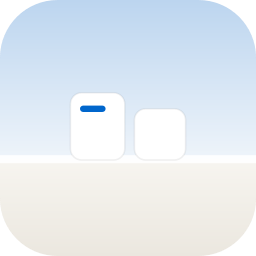
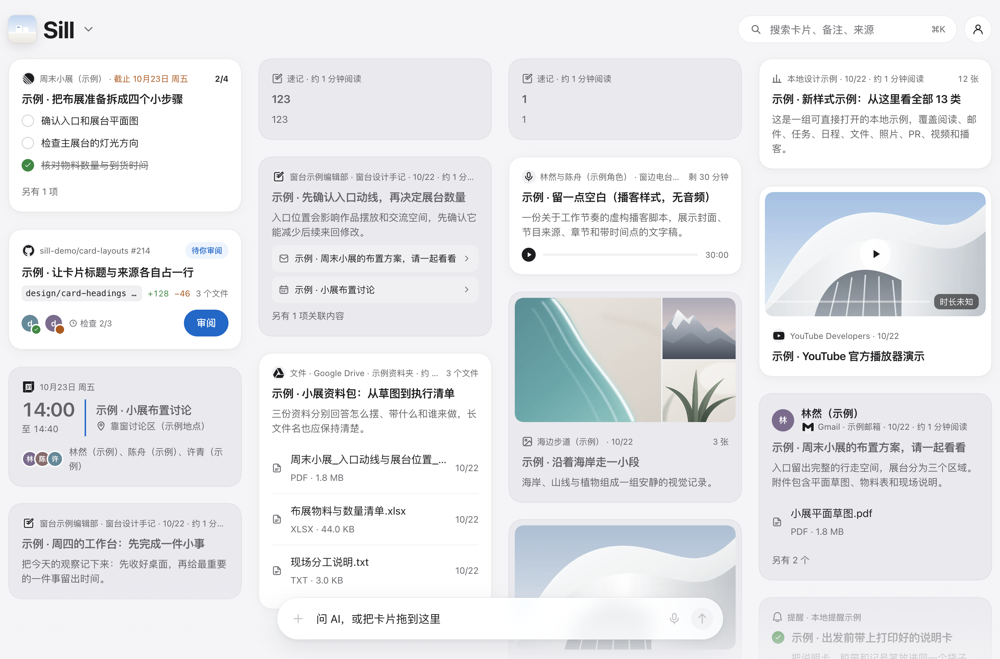

# Sill · 窗台

由 AI 助手整理内容的个人卡片工作台。

> 东西在光里，安放一会儿。

让助手创建和整理卡片，在 Web、PWA 或 Mac 中阅读、查找内容，查看待办与日程，完成收藏、勾选、提醒和备注。

[打开 Web](https://sill-web-preview.scs1213-temp-email.workers.dev) · [版本与下载](https://github.com/dabaige53/sill/releases) · [连接助手](docs/implementation/agent-mcp.md) · [文档](docs/README.md)



*2026-10-29 用户提供的本地示例截图，用于展示布局；不代表线上版本或外部服务连接状态。*

## 用 Sill 做什么

- **让助手整理内容**：将文章、笔记、邮件、任务和日程整理成卡片，保留来源与关联内容。
- **集中阅读与查找**：在同一个工作台浏览卡片，通过搜索、标签和筛选找到内容。
- **完成轻操作**：收藏、稍后读、勾选待办、设置提醒、添加备注与归档。正文和结构字段交给助手处理。

## 开始使用

1. 打开 Web 并登录已有账号；手机可通过浏览器添加到主屏幕，以 PWA 使用。
2. 在支持 Sill 的助手宿主中连接 Sill，完成账号授权。可用工具见 [MCP 说明](docs/implementation/agent-mcp.md)。
3. 告诉助手要整理什么，再到 Sill 阅读和处理卡片。例如：“把这篇文章整理成阅读卡片，保留原文链接。”

Mac 安装包目前供内部测试，采用临时签名且未经公证；以 Releases 中实际附件为准。原生 iOS 界面尚未完成，手机使用 Web/PWA。各端支持见[功能矩阵](docs/implementation/feature-matrix.md)。

## 手机卡片详情


*2026-10-29 用户提供的本地示例截图。图中的 PR、人物与检查结果是合成示例，不对应真实 GitHub 审阅。*

## 数据与边界

发布版使用服务器端账号数据。外部内容由助手整理后写入，Sill 不自动同步来源，也不提供 RSS 订阅或文件导入。卡片中的状态不代表外部操作已经完成；内置对话执行尚未实现。

产品范围见 [PRODUCT.md](docs/agent/PRODUCT.md)，后续方向见[路线图](docs/plans/roadmap.md)。图标与截图的使用说明见[品牌素材](docs/implementation/brand-assets.md)。

## 本地开发

Node.js 版本按 `package.json` 的 `engines` 要求。Mac 构建另需 Xcode 工具链，见 [Apple 应用说明](apps/apple/README.md)。

```sh
npm ci
npm run build
npm start
```

打开[本地卡片页面](http://127.0.0.1:4318/#feed)。服务只监听本机，数据保存在 `.sill/local/cards.json`。它与 Mac 本地测试数据、云端账号数据分别存储。

开发 Web 界面时，在本地服务运行后另开终端执行 `npm run dev`，访问 http://localhost:5173。Web 使用 React、TypeScript 和 Vite，Mac 使用 SwiftUI；Web 构建输出供本地网页、云端网页和 MCP 宿主使用。

## AI 操作

本地 CLI 的读取、能力查询与批量写入方法见[本地操作](docs/implementation/operations/local-operations.md)。云端工具、权限和限制见[Agent 与 MCP](docs/implementation/agent-mcp.md)。

## 开发与文档

- [Changelog](docs/records/CHANGELOG.md)：版本变化与未发布调整。
- [LICENSE](docs/LICENSE)：Copyright (c) 2026 wuwenyuan，保留所有权利，暂不开放授权。
- [文档目录](docs/README.md)：项目准则、设计规范、实现说明及按需查阅的任务材料。
- [脚本目录](scripts/README.md)与[测试目录](tests/README.md)：构建输入、输出和检查入口。
- [设计系统](design-system/README.md)：手册、变量、组件与画板。
- [发布操作手册](docs/implementation/operations/release-runbook.md)：准备候选、部署与验收步骤。
