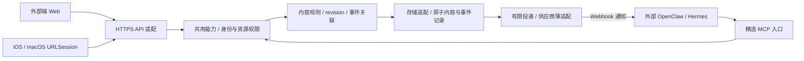

# V1 三端接口与交接包

状态：`sill-v1-draft1`，2026-10-13。**契约设计与本地准备，不是已实现 API。** 当前入口仍是 [LOCAL-OPERATIONS](LOCAL-OPERATIONS.md)；本包不改变运行代码。代码实现、部署、真实连接需确认后执行。方向和技术候选统一见 [AGENT-MCP](AGENT-MCP.md)，不重复维护选型。

“三端”暂解释为外部端（独立 Web + 外部 AI/MCP 消费方）、macOS 原生端、iOS 原生端，可调整。三端共享 HTTPS 内容能力，外部 AI 使用精选 MCP 工具；iOS/Mac 不负责承载 Webhook 或常驻 agent。

## 文件与离线使用

| 文件 | 用途 |
| --- | --- |
| [openapi.json](examples/v1/openapi.json) | OpenAPI 3.1：8 个 HTTP 操作，含无敏感数据 health；请求、响应及统一错误 schemas |
| [mcp-tools.json](examples/v1/mcp-tools.json) | 7 个精选工具的独立 input/output JSON Schema、operationId 与权限映射；未注册 |
| [fixtures.json](examples/v1/fixtures.json) | 11 个合成、相互独立的请求/响应：CRUD、投递、ack、结果、冲突；不是实时执行记录 |
| [SillClient.swift](examples/v1/SillClient.swift) | Foundation/Codable/async-await 的小型原生调用示例，不是完整 App |
| [check-v1-contracts.py](../scripts/check-v1-contracts.py) | 离线检查 schema、映射、样例及反例，或只打印样例；不联网、不安装 |
| [smoke-v1-health.mjs](../scripts/smoke-v1-health.mjs) | 只读 GET，限制字面 loopback IP、拒绝重定向、无凭据；不启动服务 |

```sh
python3 scripts/check-v1-contracts.py
python3 scripts/check-v1-contracts.py sample result
node scripts/smoke-v1-health.mjs
node scripts/smoke-v1-health.mjs http://127.0.0.1:4318 --v1
```

检查器使用本环境已有 Python `jsonschema`，未增加项目依赖；缺少时明确退出失败，不自动安装。样例打印仅用标准库。现有 Node 24 可运行 health 脚本；服务未启动或 V1 未实现时退出非零。默认检查旧 `/health`，通过也不能说明 V1 可用；`--v1` 检查设计中的 `/api/v1/health`，即使通过仍不是业务验收。没有外部写入、真实 Webhook 或部署脚本。

## 架构与责任



模块化单体：一个业务服务，不自建 HTTP 框架、MCP 协议栈或工作流平台。框架候选未定。身份提供方负责登录与令牌发行；Sill 负责令牌校验、工具范围、资源归属、版本和幂等；外部 agent 负责推理、工具执行及真实结果。Sill 只持久化最小事件和回写，不内置 LLM、agent runtime 或聊天引擎。选用数据库后须落实内容/事件/幂等记录事务，JSON 单进程实现不能自动视为支持多实例。

现有 `local-state.mjs` 混合规则与文件存储，`local.mjs` 混合 HTTP 与组装；Web `app.js` 混合视图、来源和导入，`local-sync.js` 混合变更计算、草稿与同步。按这些职责逐步抽取；保留 Web 动画、焦点、滚动和草稿恢复。两个 P1（在线整卡覆盖、来源虚假成功/RSS 地址未存）均未修；行内编辑 baseline 被轮询吸收的风险仍需浏览器验证。

## HTTP 与 MCP 的最小映射

设计服务器基址为占位 `https://api.sill.invalid/api/v1`，不可调用；以下名称可在实现前调整。

| HTTP | MCP | 权限 |
| --- | --- | --- |
| GET /contents、GET /contents/{id} | sill_listContents、sill_getContent | content:read |
| POST /contents | sill_createContent | content:write |
| PATCH /contents/{id} | sill_updateContent | content:write；带结果 metadata 还需 event:result |
| DELETE /contents/{id} | sill_deleteContent | content:delete |
| POST /events、GET /events/{id} | sill_submitEvent、sill_getEvent | event:submit、event:read |

HTTP `Idempotency-Key` 对应 MCP 参数 `idempotency_key`；path id 对应工具 id，body 保持相同 schema。MCP 返回 `structuredContent` 与 HTTP 成功 schema 一致，文本内容只作兼容展示；业务错误使用 `isError:true` 和统一 Error JSON，不泄露未授权资源详情。协议级错误交成熟 MCP SDK。MCP 单入口路径建议 `/mcp`，采用成熟 Streamable HTTP 实现；不是把 JSON-RPC 另写进 OpenAPI REST routes。

health 只暴露版本与就绪状态，不返回配置或秘密。Web 使用同源或明确 CORS 允许列表；若后续改用 cookie 会话，须另加 CSRF 防护，不能把 loopback 的信任规则直接搬到公网。OAuth 客户端流程复用选定身份提供方，不在本包实现令牌发行。

所有业务入口由服务端验证真实 caller、issuer/audience/expiry、scope、账号/资源归属；客户端不能传 owner 或角色提权。不可见资源返回 404，已认证但缺少操作 scope 返回 403。外部 agent 的 result 权限仅限分派给该身份的 event/card，提交事件目标也只能是已授权 destination_ref。默认不公开删除/事件再投递工具给 agent；内容 read/write 与结果权限按需要授予。安装 MCP 不等于公开工具；V1 无上游桥接和内置助手委托，目录中不列这些工具。

## 数据、同步与并发规则

- 稳定 ID：服务端生成内容 ID；客户端持久生成 event_id/幂等键，同一动作重试复用。大小写敏感、不复用已删除 ID。所有时间为服务端 RFC 3339 UTC，客户端时间不作排序或冲突依据。
- 内容 revision 是**每条内容**的安全整数，创建从 1 开始，每次实际改变递增；当前 local 的全局 revision 不可直接套用。PATCH/DELETE 必须提供编辑起点 expectedRevision，冲突 409；不得先用轮询的新 revision 包装旧草稿。GET 后合并再形成新动作，超时重试复用原键。
- PATCH 至少包含非空 changes 或结果 metadata；仅结果回写同样校验 expectedRevision。PATCH 是字段级变更：未提供字段不变，body 数组整体替换，state 子字段合并；不接受 null 清空，空 body 数组可清正文。read/done/archived 是 Sill 本地状态，外部完成须 event 回执；不各造 endpoint。通用 V1 内容字段只是最小模型，不删除现有卡片专属字段：实现 adapter 必须无损保留旧 tasks/event/media 等数据，专属可编辑字段确认后扩 schema，禁止静默丢字段。
- 列表首请求无 cursor/since；分页 next_cursor 锁定一个服务端一致性快照，按稳定次序遍历，客户端只回传 cursor，不与 since 混用。最后一页 sync_cursor 是该快照的增量水位；保存水位前完成所有页。后续 `since=sync_cursor` 取得之后的更新/删除 tombstone，再同样分页；并发修改进入下一轮，不漏改动。游标不透明、绑定身份与查询，过期 410 cursor_expired 后重做全量。具体保留时长部署前确认，不能静默返回不完整增量。
- 删除返回 revision 递增的 tombstone，清除 title/body/url 的敏感内容（title 可固定“已删除”）；增量仍能移除客户端缓存。GET 已删除内容返回 404，幂等删除重放仍返回原 tombstone。服务端管理 tombstone/游标共同保留周期，避免删除后“复活”。
- 所有写入须幂等键，绑定 caller + operation/resource + 规范化请求摘要。同键同请求返回原状态码/结果，不重复执行；同键不同请求 409。鉴权先于重放查找，幂等原结果检查先于版本校验。事件 ID 的去重持久保存；普通写键至少覆盖离线重试窗口，建议 7 天（待确认），过期后不盲目重发创建。事务提交前不返回成功。
- 所有错误为 Error schema；400 参数、401 身份、403 权限、404 不可见、409 冲突、410 游标过期、429 限流、503 暂不可用。429/503 可含 retry_after_seconds；服务端日志与错误脱敏。读取可有界退避，写入超时表示结果未知，取消本地请求不代表撤销服务器写入。

## 事件与两家薄适配

V1 首先只开放 summarize / complete 两种意图，且按配置启用。POST /events 在持久化后返回 202 queued/pending；不能将它当作外部助手已接收。投递成功 ack 仅改 delivery=accepted，outcome 仍 pending；投递超时为 unknown，明确失败为 failed，均不冒充业务结果。业务 outcome 只有关联结果回写后才变 succeeded/failed/unknown。

薄适配输入是服务端已持久化的 event_id/card_id/card_version/action，以及配置引用 destination_ref；不接受通知正文中的任意 URL、secret 或工具列表。通知只带标识及经批准动作，正文由助手通过 MCP 读取。目标 URL 由服务端安全配置管理，校验协议、主机、解析 IP 及每次重定向（默认拒绝），阻止未授权内网/云元数据访问；有意连接本机助手须单独配置范围，不能放开任意内网。

| 适配器 | 最小通知与凭据边界 | ack 与重放 |
| --- | --- | --- |
| OpenClaw | `POST /hooks/agent`；JSON `{"message":"Sill event=event_demo card=card_demo version=1 action=summarize; read via Sill MCP","agentId":"configured-agent"}`；Bearer 或 x-openclaw-token 由服务端注入，不放 message | 200/runId 只代表接收；Idempotency-Key 使用稳定事件键，上游短缓存不替代 Sill 持久去重 |
| NousResearch Hermes Agent | `POST /webhooks/<route-name>`；Sill 自定 JSON `{"event_id":"event_demo","card_id":"card_demo","card_version":1,"action":"summarize"}`，配置 route 的模板把这些字段传给助手；GenericV2 按 timestamp + `.` + 原始 body 签名，不重新序列化再验签 | X-Request-ID 使用 event_id；普通 agent 路由 202 accepted/delivery_id 非完成；route 默认工具受限，明确允许 Sill MCP 工具 |

以上 Hermes JSON 是拟议的 route 模板输入，不声称供应商有同名固定字段。用户 Hermes 产品/版本尚未确认；官方来源与能力核验见 [统一方案](AGENT-MCP.md)。没有供应商启动或真实投递脚本。

外部助手先读最新内容，再 PATCH 带 expectedRevision、metadata.event_id/outcome/summary；服务端核验事件目标与分派身份，将内容修改、事件结果、去重原子落库，再返回成功。事件原 card_version 与当前内容不同须核对原意图是否仍适用；不能仅换新 revision 重做已发生的外部动作。重复结果重放不再增加 revision，不再投递同一事件；来源/因果标记由服务端记录，客户端不能伪造内部 origin。

失败或 unknown 可仅回写 metadata，不伪造内容变更；此时内容 revision 不增加，事件 result_revision 记录核对过的内容版本。不把 complete 的外部未确认结果写成 done=true。迟到结果若与终态矛盾，返回 409，留待核对，不能覆写已确认结果。不提供通用 callback 或任务取消 endpoint；无结果时先查 Sill GET /events，供应商查询仅在确认真实能力后使用，否则显示待核对。默认最多 3 次短期退避投递（建议 1/5/30 秒并带抖动），认证失败不重试；结果未知或超过上游去重窗口时停止自动重放。所有数字是待确认策略，不是已实现保障。

## 原生客户端

首期选择通用 HTTPS JSON + 前台增量拉取；启动、回前台、用户刷新时同步，活跃等待事件时有界轮询并退避。**V1 不引入 SSE/WebSocket**，以后确需实时推送再加一个可恢复流，推送只作变更提示，水位同步仍为真值。iOS 不假定后台常驻；Mac 也不因桌面形态承担服务器可靠性。

采用 [URLSession async/await（Apple WWDC）](https://developer.apple.com/videos/play/wwdc2021/10095/) 与 Codable；Swift 示例覆盖 7 个业务操作、统一错误和 revision，保留原始时间字符串。视图在 MainActor 更新；离开视图可取消读取，写入取消/超时保留草稿、幂等键及未知状态，409 引导合并。示例不实现持久草稿、登录刷新或完整同步循环，不能作为完整客户端验收。

凭据使用 [Keychain services](https://developer.apple.com/documentation/security/keychain-services)，不要写 UserDefaults、日志或通知正文。若选 OAuth，采用 [ASWebAuthenticationSession](https://developer.apple.com/documentation/authenticationservices/aswebauthenticationsession) 与供应商支持的 PKCE/回调校验；客户端不嵌入服务端 secret。登录提供方、回调 URL、entitlements 和 scope 尚待确定。不强制 Swift 后端或 CloudKit。

Apple 文档入口与 URLSession 官方讲解已核验；部分 API 正文受 Apple 动态页面/抓取限制，Keychain、认证会话及 [BackgroundTasks](https://developer.apple.com/documentation/backgroundtasks) 仍需在 Xcode 官方文档核对平台最低版本和具体配置。当前环境无 Swift/Xcode，示例未编译、未做 Apple 设备或后台行为验证；不能以 JSON 检查通过替代原生验证。

## 阶段与验收门槛

| 阶段 | 最小交付与退出条件 |
| --- | --- |
| 当前准备 | 文档/schema/样例一致；两个 P1 明确保留；确认 API 命名、用户 Hermes、授权提供方与最少部署组件后才实施 |
| 最小实现（待确认） | 修复 P1 并抽实际模块；实现内容/事件事务、版本/幂等、受限 MCP；未实现接口返回明确错误；模拟投递即可，不接真实账号 |
| 联调（单独授权） | 一个外部助手完成通知→读卡→结果回写；重复投递不重复执行、ack 不算完成、跨身份拒绝、迟到/409/超时不丢数据、SSRF 与循环被阻止；认证秘密不外泄 |
| 三端验收 | Web 保持窄屏/键盘/焦点/减少动效与恢复回归；iOS/Mac 实机或模拟器覆盖登录、分页/增量/删除、离线草稿、409、取消后恢复、前后台切换；VoiceOver、Dynamic Type、键盘导航另测 |
| 后续可选 | 上游工具桥接、内置 agent 委托、实时流分别评估；不得以本交接包视为已批准实现或部署 |

新 contract 与当前 `/api/local` 并存/迁移策略必须确认；不更改既有 CLI 参数、不破坏旧卡片专属字段、不把当前全局 revision 偷换成内容 revision。实现阶段再运行仓库现有 local/core/browser/accessibility/local-browser/package 检查和真实契约/权限测试。本轮只完成准备脚本和静态契约验证。
