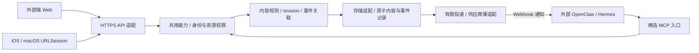

# V1 三端接口与交接包

更新：2026-10-16。

设计标识：`sill-v1-draft1`（历史标识，非产品版本）。内容 API/MCP 已有实现；工作区数据接口已实现并发布。Webhook、内置助手和可靠执行器仍是设计与准备。独立本地通道见 [本地操作](local-operations.md)；部署和真实外部连接不由本包自动启用。方向和技术候选统一见 [AGENT-MCP](../product/agent-mcp.md)，不重复维护选型。

“三端”暂解释为外部端（独立 Web + 外部 AI/MCP 消费方）、macOS 原生端、iOS 原生端，可调整。三端共享 HTTPS 内容能力，外部 AI 使用精选 MCP 工具；iOS/Mac 不负责承载 Webhook 或常驻 agent。

## 文件与离线使用

| 文件 | 用途 |
| --- | --- |
| [openapi.json](../../contracts/design/openapi.json) | OpenAPI 3.1：10 个 HTTP 操作，含无敏感数据 health；请求、响应及统一错误 schemas |
| [mcp-tools.json](../../contracts/design/mcp-tools.json) | 9 个数据工具的独立 input/output JSON Schema 与权限约束；工作区工具已发布 |
| [fixtures.json](../../contracts/design/fixtures.json) | 11 个合成、相互独立的请求/响应：CRUD、投递、ack、结果、冲突；不是实时执行记录 |
| [SillClient.swift](../../contracts/design/SillClient.swift) | Foundation/Codable/async-await 的小型原生调用示例，不是完整 App |
| [check-contracts.ts](../../scripts/check-contracts.ts) | 离线检查 schema、映射、样例及反例，或只打印样例；不联网、不安装 |
| [smoke-health.ts](../../scripts/smoke-health.ts) | 只读 GET，限制字面 loopback IP、拒绝重定向、无凭据；不启动服务 |

```sh
node scripts/check-contracts.ts
node scripts/check-contracts.ts sample result
node scripts/smoke-health.ts
node scripts/smoke-health.ts http://127.0.0.1:4318 --v1
```

检查器使用项目已有 Node 与 JSON Schema 校验依赖，离线核对契约及样例。health 脚本只做受限只读检查；服务未启动时退出非零。`--v1` 检查 `/api/v1/health`，通过只证明该就绪响应可读，不代替业务、权限或发布验收。不执行真实 Webhook。

## 架构与责任



模块化单体：一个业务服务，不自建 HTTP 框架、MCP 协议栈或工作流平台。云端使用现有 HTTP 适配、官方 MCP SDK 与 Supabase 数据/Auth。身份提供方负责登录与令牌发行；Sill 负责令牌校验、工具范围、资源归属、版本和幂等；外部 agent 负责推理、工具执行及真实结果。Sill 只持久化最小事件和回写，不内置 LLM、agent runtime 或聊天引擎。云端数据函数已将内容、状态与幂等记录纳入数据库事务；本地 JSON 通道仍独立，不能据此视为云端多实例存储。

本地代码位于 `server/local/`，云端代码位于 `server/cloud/`，Web 位于 `apps/web/`。整卡、备注和标签编辑保留原始基准，冲突保留草稿；来源授权、RSS 订阅与文件导入入口已按 ADR 0033 删除。新增工作区数据操作已验证事务、冲突、回放和调用方隔离；网页已发布，检查层次见[发布记录](../records/2026-10-16-cloud-operations/README.md)。

## HTTP 与 MCP 的最小映射

契约示例基址 `https://api.sill.invalid/api/v1` 是不可调用的占位值；实际使用当前连接的服务。下表为仓库已实现的数据接口，工作区接口已发布。

| HTTP | MCP | 权限 |
| --- | --- | --- |
| GET /contents、GET /contents/{id} | sill_listContents、sill_getContent | content:read |
| POST /contents | sill_createContent | content:write |
| PATCH /contents/{id} | sill_updateContent | content:write；带结果 metadata 还需 event:result |
| DELETE /contents/{id} | sill_deleteContent | content:delete |
| POST /events、GET /events/{id} | sill_submitEvent、sill_getEvent | event:submit、event:read |
| GET /workspace | sill_getWorkspace | content:read，且可读整个工作区 |
| POST /workspace/operations | sill_applyOperations | 可读整个工作区；每项另验 content:write / content:delete 与目标资源 |

HTTP `Idempotency-Key` 对应 MCP 参数 `idempotency_key`；path id 对应工具 id，body 保持相同 schema。MCP 返回 `structuredContent` 与 HTTP 成功 schema 一致，文本内容只作兼容展示；业务错误使用 `isError:true` 和统一 Error JSON，不泄露未授权资源详情。协议级错误交成熟 MCP SDK。MCP 单入口路径为 `/mcp`，采用成熟 Streamable HTTP 实现；不是把 JSON-RPC 另写进 OpenAPI REST routes。

health 只暴露版本与就绪状态，不返回配置或秘密。Web 使用同源或明确 CORS 允许列表；浏览器 cookie 写入校验同源，提供 CSRF 防护，不能把 loopback 的信任规则直接搬到公网。OAuth 客户端流程复用选定身份提供方，不在本包实现令牌发行。

所有业务入口由服务端验证真实 caller、issuer/audience/expiry、scope、账号/资源归属；客户端不能传 owner 或角色提权。不可见资源返回 404，已认证但缺少操作 scope 返回 403。外部 agent 的 result 权限仅限分派给该身份的 event/card，提交事件目标也只能是已授权 destination_ref。默认不公开删除/事件再投递工具给 agent；内容 read/write 与结果权限按需要授予。安装 MCP 不等于公开工具；V1 无上游桥接和内置助手委托，目录中不列这些工具。

## 数据、同步与并发规则

- 稳定 ID：单卡 create 由服务端生成内容 ID；工作区 card.upsert 新建由调用方提供 ID 和 before:null；客户端持久生成 event_id/幂等键，同一动作重试复用。大小写敏感、不复用已删除 ID。云端 created_at/updated_at 使用服务端 RFC 3339 UTC；卡片与状态的业务时间使用契约定义的毫秒数，不用客户端时间代替版本保护。
- 内容 revision 是**每条内容**的安全整数，创建从 1 开始，每次实际改变递增；当前 local 的全局 revision 不可直接套用。PATCH/DELETE 必须提供编辑起点 expectedRevision，冲突 409；不得先用轮询的新 revision 包装旧草稿。GET 后合并再形成新动作，超时重试复用原键。
- PATCH 至少包含非空 changes 或结果 metadata；仅结果回写同样校验 expectedRevision。PATCH 是字段级变更：未提供字段不变，body 数组整体替换，state 子字段合并；不接受 null 清空，空 body 数组可清正文。read/done/archived 是 Sill 本地状态，外部完成须 event 回执；不各造 endpoint。内容契约已覆盖任务、时间、来源与展示字段，更新保留未知卡片字段，不能静默丢字段。
- 列表首请求无 cursor/since；分页 next_cursor 锁定一个服务端一致性快照，按稳定次序遍历，客户端只回传 cursor，不与 since 混用。最后一页 sync_cursor 是该快照的增量水位；保存水位前完成所有页。后续 `since=sync_cursor` 取得之后的更新/删除 tombstone，再同样分页；并发修改进入下一轮，不漏改动。游标不透明、绑定身份与查询，过期 410 cursor_expired 后重做全量。具体保留时长部署前确认，不能静默返回不完整增量。
- 删除返回 revision 递增的 tombstone，清除 title/body/url 的敏感内容（title 可固定“已删除”）；增量仍能移除客户端缓存。GET 已删除内容返回 404，幂等删除重放仍返回原 tombstone。服务端管理 tombstone/游标共同保留周期，避免删除后“复活”。
- 所有写入须幂等键，绑定 caller + operation/resource + 规范化请求摘要。同键同请求返回原状态码/结果，不重复执行；同键不同请求 409。鉴权先于重放查找，幂等原结果检查先于版本校验。事件 ID 的去重持久保存；普通写键至少覆盖离线重试窗口，当前为 7 天，过期后不盲目重发创建。事务提交前不返回成功。
- 所有错误为 Error schema；400 参数、401 身份、403 权限、404 不可见、409 冲突、410 游标过期、429 限流、503 暂不可用。429/503 可含 retry_after_seconds；服务端日志与错误脱敏。读取可有界退避，写入超时表示结果未知，取消本地请求不代表撤销服务器写入。

Web 的人用内容入口限轻量速记和新增；已有内容通过 MCP 修改。阅读、收藏、稍后看和任务状态保留页面动作，不据此提供复杂人工结构编辑界面。

## 工作区快照与原子批量

`GET /workspace` 与 `sill_getWorkspace({})` 返回 `{revision,state:{cards,items,preferences,seconds}}`。`cards` 保留完整 content_json 字段，含归档、不含已删除卡片；`items` 返回完整状态默认值，`preferences` 返回完整偏好默认值。助手在快照中筛选或导出，不向列表工具添加未定义的查询参数。

`POST /workspace/operations` 的 body 为 `{operations,expectedRevision?}`，HTTP 必须带 `Idempotency-Key`；对应 MCP 参数 `{idempotency_key,body}`。最多 5000 项、512 KiB；所有操作在同一数据库事务内执行，一项失败整批回滚。旧单卡写入与批量写入锁定同一工作区记录，共用 `change_version`，不会分别形成不相干的版本。

支持 `card.upsert / card.delete / item.patch / preferences.patch / reading.add`。除原子累加的 `reading.add` 外，每项须保留原始 `before` 或由工作区 `expectedRevision` 保护。新建 card.upsert 必须 `before:null`，已有 ID 不能覆盖或复用。整卡 before 可保留云端元字段，但写入 card 必须去掉 state、revision、created_at、updated_at、deleted；不得传 owner_id 或 change_version。整卡条件比较内容，单卡 API 仍按单卡 revision 校验。

状态与偏好的 before 按所带字段比对；不带工作区版本时须覆盖所有修改字段。状态支持完整阅读、收藏、标签、备注、子任务、提醒、归档、lessLike；偏好与 Web 定义一致。任务 done/taskDone 与提醒 done/reminderDone 双向同步，taskDone 只能引用卡片内任务。reading.add 每次累加 0–86400 整数秒，总值最多 10000000。完整字段表与调用示例见 [操作协议](../../skills/sill/references/operations.md)。

删除明确选定的多张卡片使用带 before 的 card.delete 列表；清空可用读取时的全局版本保护整批，不提供无条件 delete all。不能把要求原子完成的清空拆批，或在部分成功时称为全部完成。批量成功回放返回原结果，不重复执行；原结果可能早于后续编辑，需要最新状态时另读快照。授权先于回放，所有返回均限当前身份的工作区。

账号切换保护：数据 HTTP 可选带 `X-Sill-Owner`，MCP 数据工具可选带 `expected_owner`；必须与实际鉴权账号一致，否则 403，且不执行读写。该条件不是授权。`/auth/session` 返回 userId、有效 scopes 与工作区权限；MCP 打开工具返回稳定 userId，供宿主绑定草稿和重试。

新增数据接口不包含事件 metadata、Webhook 投递或外部执行。当前没有工具允许列表的独立存储配置；运行时按调用方 scopes、资源范围、身份与当前发现的工具检查，不以新增接口自动扩权。

## 事件与两家薄适配

事件记录接口支持 summarize / complete 两种意图，且按配置和授权启用。以下 Webhook 投递与 ack 流程仍待实现。POST /events 在持久化后返回 202 queued/pending；不能将它当作外部助手已接收。投递成功 ack 仅改 delivery=accepted，outcome 仍 pending；投递超时为 unknown，明确失败为 failed，均不冒充业务结果。业务 outcome 只有关联结果回写后才变 succeeded/failed/unknown。

薄适配输入是服务端已持久化的 event_id/card_id/card_version/action，以及配置引用 destination_ref；不接受通知正文中的任意 URL、secret 或工具列表。通知只带标识及经批准动作，正文由助手通过 MCP 读取。目标 URL 由服务端安全配置管理，校验协议、主机、解析 IP 及每次重定向（默认拒绝），阻止未授权内网/云元数据访问；有意连接本机助手须单独配置范围，不能放开任意内网。

| 适配器 | 最小通知与凭据边界 | ack 与重放 |
| --- | --- | --- |
| OpenClaw | `POST /hooks/agent`；JSON `{"message":"Sill event=event_demo card=card_demo version=1 action=summarize; read via Sill MCP","agentId":"configured-agent"}`；Bearer 或 x-openclaw-token 由服务端注入，不放 message | 200/runId 只代表接收；Idempotency-Key 使用稳定事件键，上游短缓存不替代 Sill 持久去重 |
| NousResearch Hermes Agent | `POST /webhooks/<route-name>`；Sill 自定 JSON `{"event_id":"event_demo","card_id":"card_demo","card_version":1,"action":"summarize"}`，配置 route 的模板把这些字段传给助手；GenericV2 按 timestamp + `.` + 原始 body 签名，不重新序列化再验签 | X-Request-ID 使用 event_id；普通 agent 路由 202 accepted/delivery_id 非完成；route 默认工具受限，明确允许 Sill MCP 工具 |

以上 Hermes JSON 是拟议的 route 模板输入，不声称供应商有同名固定字段。用户 Hermes 产品/版本尚未确认；官方来源与能力核验见 [统一方案](../product/agent-mcp.md)。没有供应商启动或真实投递脚本。

外部助手先读最新内容，再 PATCH 带 expectedRevision、metadata.event_id/outcome/summary；服务端核验事件目标与分派身份，将内容修改、事件结果、去重原子落库，再返回成功。事件原 card_version 与当前内容不同须核对原意图是否仍适用；不能仅换新 revision 重做已发生的外部动作。重复结果重放不再增加 revision，不再投递同一事件；来源/因果标记由服务端记录，客户端不能伪造内部 origin。

失败或 unknown 可仅回写 metadata，不伪造内容变更；此时内容 revision 不增加，事件 result_revision 记录核对过的内容版本。不把 complete 的外部未确认结果写成 done=true。迟到结果若与终态矛盾，返回 409，留待核对，不能覆写已确认结果。不提供通用 callback 或任务取消 endpoint；无结果时先查 Sill GET /events，供应商查询仅在确认真实能力后使用，否则显示待核对。默认最多 3 次短期退避投递（建议 1/5/30 秒并带抖动），认证失败不重试；结果未知或超过上游去重窗口时停止自动重放。所有数字是待确认策略，不是已实现保障。

## 原生客户端

首期选择通用 HTTPS JSON + 前台增量拉取；启动、回前台、用户刷新时同步，活跃等待事件时有界轮询并退避。**V1 不引入 SSE/WebSocket**，以后确需实时推送再加一个可恢复流，推送只作变更提示，水位同步仍为真值。iOS 不假定后台常驻；Mac 也不因桌面形态承担服务器可靠性。

采用 [URLSession async/await（Apple WWDC）](https://developer.apple.com/videos/play/wwdc2021/10095/) 与 Codable；Swift 示例覆盖 7 个业务操作、统一错误和 revision，保留原始时间字符串。视图在 MainActor 更新；离开视图可取消读取，写入取消/超时保留草稿、幂等键及未知状态，409 引导合并。示例不实现持久草稿、登录刷新或完整同步循环，不能作为完整客户端验收。

凭据使用 [Keychain services](https://developer.apple.com/documentation/security/keychain-services)，不要写 UserDefaults、日志或通知正文。若选 OAuth，采用 [ASWebAuthenticationSession](https://developer.apple.com/documentation/authenticationservices/aswebauthenticationsession) 与供应商支持的 PKCE/回调校验；客户端不嵌入服务端 secret。登录提供方、回调 URL、entitlements 和 scope 尚待确定。不强制 Swift 后端或 CloudKit。

Apple 文档入口与 URLSession 官方讲解已核验；部分 API 正文受 Apple 动态页面/抓取限制，Keychain、认证会话及 [BackgroundTasks](https://developer.apple.com/documentation/backgroundtasks) 仍需在 Xcode 官方文档核对平台最低版本和具体配置。当前环境无 Swift/Xcode，示例未编译、未做 Apple 设备或后台行为验证；不能以 JSON 检查通过替代原生验证。

## 阶段与验收门槛

| 阶段 | 最小交付与退出条件 |
| --- | --- |
| 当前数据实现 | 内容与工作区 HTTP/MCP、事务/版本/幂等与受限授权已实现并本地验证；工作区接口已发布；Webhook、助手和执行器未实现 |
| 外部执行（待确认） | 确认助手实例及投递范围后实施 Webhook 与恢复机制；模拟验证与真实账号联调分开 |
| 联调（单独授权） | 一个外部助手完成通知→读卡→结果回写；重复投递不重复执行、ack 不算完成、跨身份拒绝、迟到/409/超时不丢数据、SSRF 与循环被阻止；认证秘密不外泄 |
| 三端验收 | Web 保持窄屏/键盘/焦点/减少动效与恢复回归；iOS/Mac 实机或模拟器覆盖登录、分页/增量/删除、离线草稿、409、取消后恢复、前后台切换；VoiceOver、Dynamic Type、键盘导航另测 |
| 后续可选 | 内置 agent 委托（只用 Composio 连接器）、实时流分别评估；不做上游工具桥接（ADR 0033）；不得以本交接包视为已批准实现或部署 |

云端接口与 `/api/local` 保持独立；不更改既有 CLI 参数、不破坏旧卡片专属字段，不把工作区 revision 当成单卡 revision。界面改动仍须运行对应本地、浏览器和可访问性检查。新增工作区数据层已进行本地数据库、HTTP/MCP 和授权回归；这不代替外部 Webhook、Apple 云端接入或线上发布验收。
