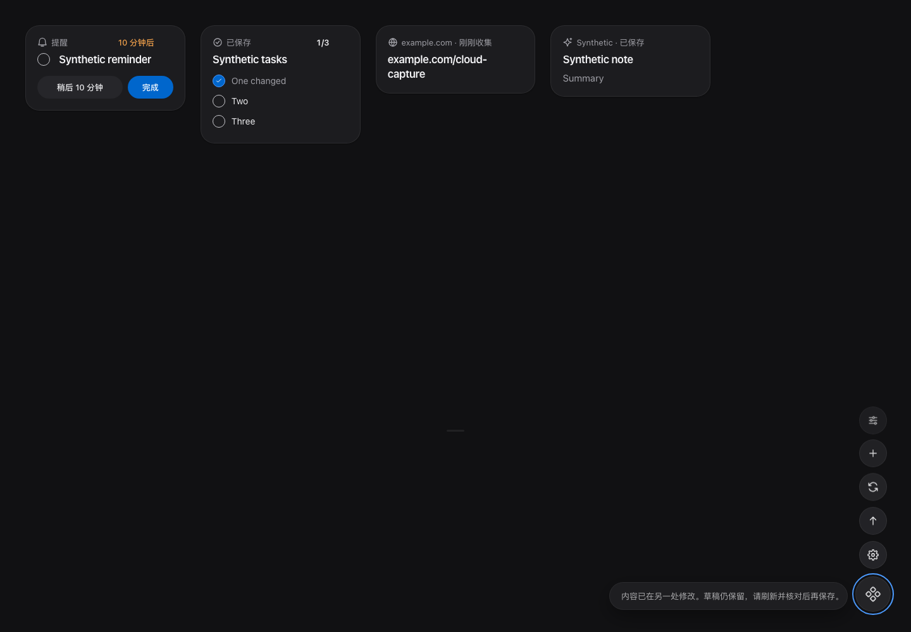
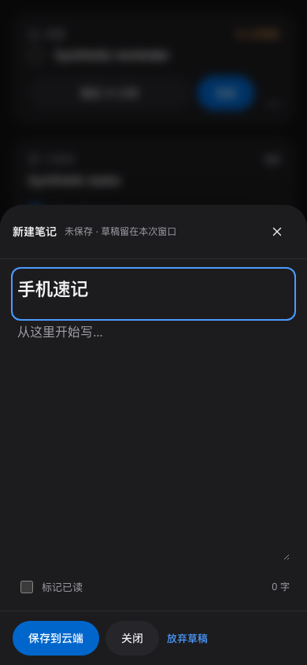
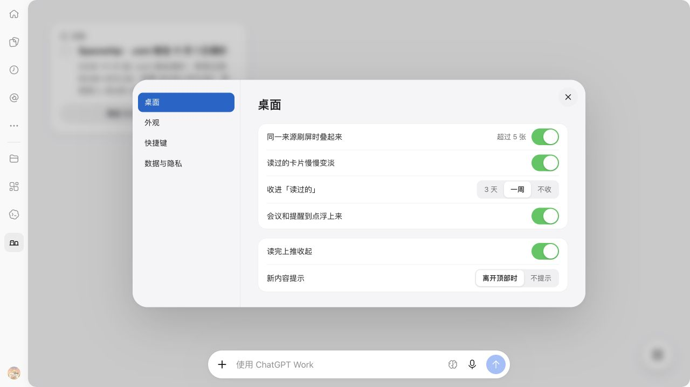

# 云端工作区操作与 Agent 优先

2026-10-16 发布产品 1.2.2。先将用户确认的产品原则写入 AGENTS.md、产品约定、需求与设计规范，再调整实现。本次不再操作 claude.ai 云端设计；既有追加内容按用户要求保留。

## 范围

- 已有卡片标题、正文、任务文字、时间、地点、出处和布局由 AI 通过 MCP 修改；云端取消整卡内容编辑器和复杂字段表单。保留新增笔记、示例、链接速记与原有阅读、收藏、稍后读、任务、提醒、搜索、筛选、设置及轻操作。
- 新增 `sill_getWorkspace` 和 `sill_applyOperations`，与网页共用完整状态、偏好、阅读秒数和批量操作。AI 可读取后筛选、统计、导出或批量整理。
- 写入使用原始字段或版本检查；批量全部成功或全部回滚。网络回执不明时重用原请求与幂等键；认证失效、切换账号、旧请求返回均不能把旧草稿写入另一个账号。
- 来源连接、RSS/OPML 与文件导入退出云端界面；卡片出处和旧兼容数据保留。首次打开保留“记一笔”和“先看示例”，清空后可重新加载示例。
- 保留原产品布局；无变化的后台刷新不重建卡片菜单。MCP 页面资源地址随产品版本更新，避免宿主继续使用旧界面。
- 未实现内置助手、Composio、Webhook 投递或持久执行器；Sill 的任务、提醒和阅读状态不表示外部动作已完成。

## 发布对象

| 对象 | 实际结果 |
| --- | --- |
| 网页 | https://sill-web-preview.scs1213-temp-email.workers.dev/ |
| Worker | `sill-web-preview`；仅更新脚本，保留绑定与配置 |
| 最终 deployment | `fba02e2e-17b9-41d5-9799-ffb5baaf969d` |
| 最终 Worker version | `287eac90-bbf2-44a8-ac24-84fdd780f324`，100% |
| Supabase | `moeabktxrgidrdkplvac`；迁移 `20261016092653_sill_workspace_operations.sql` 已应用 |
| App | `asdk_app_6ad0d805d3e88191a1c8902cf66af046`，沿用原连接 |
| 插件 | `plugin_asdk_app_6ad0d805d3e88191a1c8902cf66af046`，1.2.2，USER / PRIVATE |
| Plugin release | `pluginrel_6ad1f1308ffc81919df944e5208cacb0` |

迁移先由 Supabase CLI 创建，本地文件名随后对齐平台实际记录。未扩大账号、OAuth、卡片权限或受众。旧网页仍可调用原单卡接口；数据库迁移不删除用户卡片或旧来源配置。

## 验证

| 层次 | 结果 |
| --- | --- |
| 自动化 | `npm test`：36 项约定、65 项 Web、90 项服务端通过；后续资源版本改动的 3 项 App 测试、类型检查通过 |
| 浏览器 | 云端网页、MCP App 协议模拟、登录恢复、云端操作四套回归通过；涵盖桌面/手机、浅深主题、未知回执、冲突草稿、批量、清空、导出与不持久化私密数据 |
| 后续针对性回归 | 云端操作再次通过：不变的轮询保留卡片菜单；清空后重新加载示例使用新 ID，关联有效 |
| 线上网页 | HTTP 200，页面与本地发布产物一致；未登录工作区读取被拒绝 |
| 线上数据库 | 在回滚事务内验证批量新建、状态、任务完成、阅读秒数及同键回放；仅返回验证结果，未提交验证数据 |
| 实际连接 | 现有 Sill MCP 打开工作台成功，返回稳定账号与原有三个卡片权限 |
| 平台工具发现 | 通过原 App 的“刷新工具”后，列表包含 4 个写工具、5 个读工具；新增工作区工具已发现，事件权限未增加 |
| 真实宿主读写 | 在 ChatGPT 宿主打开新版 App；AI 创建临时笔记，页面显示；点击收藏后 MCP 读回 `bookmarked:true`、revision 2；最后删除该验证卡并收到 deleted:true、revision 3 |
| 最终页面复核 | 1.2.2 刷新连接后重新打开工作台，原“桌面、外观、快捷键、数据与隐私”设置保留，“来源”分组已删除 |
| Codex 当前聊天缓存 | 此轮已有工具描述与已打开侧栏仍保留旧定义；不把平台刷新说成此轮缓存已热更新。重新打开插件或下一轮发现工具后使用新版 |

浏览器自动化使用合成身份和数据；协议模拟不等同于真实宿主。真实宿主只验证上述临时卡流程，没有修改已有用户卡片，没有运行全库清空。Mac 本轮仅核对已有状态语义，未发布或做 GUI 验收。

桌面与手机回归截图：

## 后续维护

新增内容或状态操作先接入同一能力层，再判断是否需要页面入口；不把结构字段做成人工编辑表单。连接发现、卡片版本、未知回执与账号切换继续纳入回归。当前工作区仍含其他未提交变更，本次未提交、推送或创建 PR；`pr.md` 保持 PR 编写指南用途。
