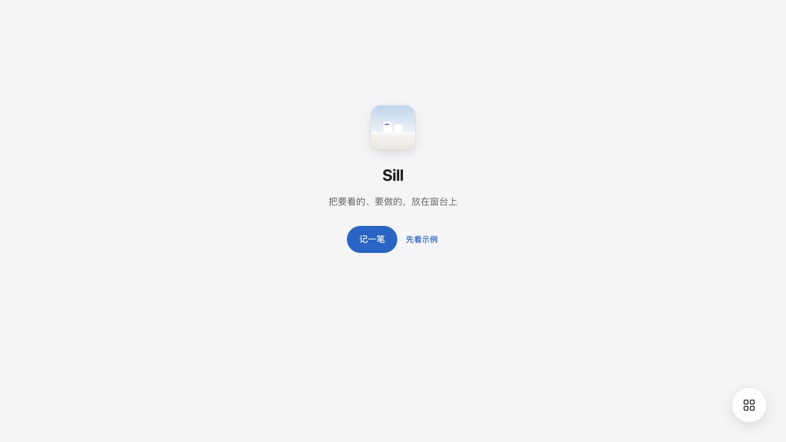
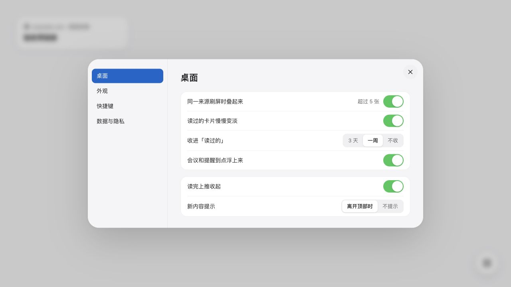

# 删除来源连接与文件导入

2026-10-16。按 ADR 0033 删除本地 Web 的来源连接和文件导入。保留速记、编辑、示例卡片、导出和卡片出处。未提交、推送或部署。

## 删除范围

- 删除设置中的来源分组、来源列表与详情、授权占位、RSS URL 订阅、首次打开的来源选择。
- 删除文件选择、导入预览、导入圆环，以及 OPML、CSV、HTML 书签、Markdown、ICS 解析器。`apps/web/services/importers.ts` 已删除；速记、链接校验与去重移至 `apps/web/services/capture.ts`。
- 删除示例来源、来源状态操作、来源差异同步和本地协议的 `source.upsert`、`source.delete`。
- 删除专用样式和未引用文案，重新生成组件包。首次打开改为“记一笔”和“先看示例”；拖放提示改为“放下即记下 / 链接或文字”。
- 叠卡只使用全局偏好；打开卡片不再读取来源的外部打开偏好。示例直接插入，不播放导入动效。

## 数据与取回

旧数据中的顶层 `sources` 作为兼容字段原样保留。浏览器备份、首次迁移到本地服务、后续写回和导出均保留该字段；不再将它用于产品操作。卡片内部的 `sources` 仍表示内容出处。

没有读取或改写真实 `.sill/local/` 或 Mac 工作区。浏览器验收使用临时目录和合成卡片。

本地标签 `sources-import-final` 当前指向 `0cae784194bc98ba389d8855177329f17dbcd52c`，已确认包含删除前的解析器。交接文件记载的提交号不同，本记录采用实际标签值，未移动标签。取回单个文件到仓库外审阅：

```sh
git show sources-import-final:apps/web/services/importers.ts > /tmp/sill-importers-before-removal.ts
```

其他文件使用同一命令替换路径。不要在当前多人改动的工作区执行整仓重置。标签中的内容属于已提交历史，不含当时未提交的并发保护等修改。

## 验证

- `npm test`：36 项约定、60 项 Web、87 项服务端测试通过；包含类型、构建、文件和 Schema 检查。
- `npm run test:local-browser`：旧来源配置保留、页面与 AI 写回、并发编辑基准、删除及重启持久化通过。既有批量编辑和未知写入结果回归继续通过。
- `npm run test:browser`：21 个场景通过，包括链接拖放、文件拖放不新增卡片、去重、首次打开、示例、设置、浅色/深色、320–2048px 布局和减少动态效果。
- 内置浏览器：首次打开、速记、设置分类和导出实测。导出 JSON 含 1 张验收链接卡片，标题和 URL 一致。
- `apps/apple/` 源码检查：没有来源连接或文件导入界面，无需修改；未进行 Mac GUI 验收。
- `git diff --check` 和 `npm run files:check` 通过。自动测试日志保存在本机临时目录及 `tests/artifacts/`，不作为发布证明。





## 遗留差异

按交接授权在当前 checkout 完成删除。线上 Design System 和设计画布尚未同步，涉及画板 24、26、31、32、`SourceRow` 组件和文案。仓库组件包已重新生成，尚未发布到线上；相关风险写入根目录 `pr.md`。没有恢复旧设计，也没有将线上同步描述为完成。

## 用途更正（2026-10-16）

用户确认 `pr.md` 用于说明如何编写 PR，不用于保存本次正文。该文件已改为编写指南，原文中“相关风险写入根目录 `pr.md`”不再适用。上述线上设计差异仍保留在本记录中；未创建或发布 PR。
