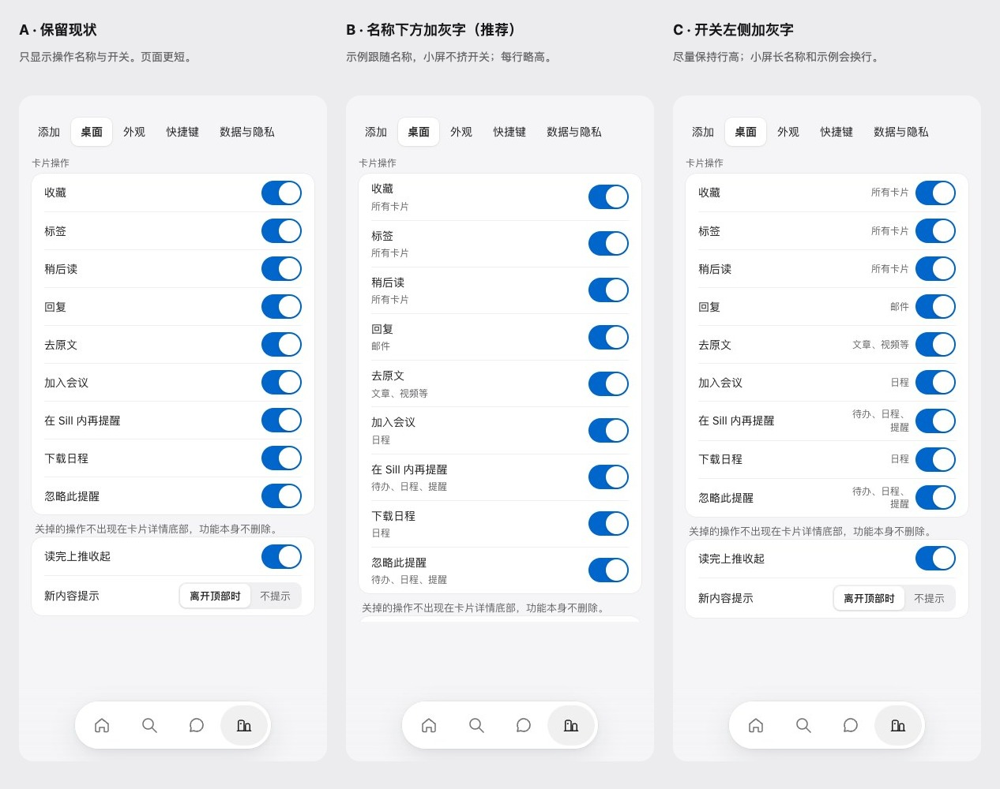

# 卡片操作设置的类型示例（U4.5）

2026-10-19。用户比较 A 保留现状、B 名称下方灰字、C 开关左侧灰字后，选择「B：名称下方灰字」。先写 [ADR 0042](../../adr/0042-card-action-type-examples.md)、手册与 Toggle 说明，再补回归和实现。只加适用类型示例，不改开关含义、顺序、状态或存储。Mac 未改。

候选来自隔离 localhost 的真实设置页，320 / 390 / 1440、浅色与深色三套共 18 张，均无横向溢出；B/C 仅注入临时灰字 DOM，不改产品源文件。最终另截实际实现。

公开参考：[Apple 设置](https://support.apple.com/en-mide/guide/iphone/iph7c3d96bab/27/ios/27)、[X 通知设置](https://help.x.com/en/managing-your-account/understanding-the-notifications-timeline)、[Things 设置](https://culturedcode.com/things/support/articles/2803567/)。参考轻设置的说明层次，不复制资产。

新增文案统一放在 zh-Hans.json。真机与 Safari 未检查；本地画板和未同步文件随原 PR #55 补齐，不访问线上设计或改变线上资产记录。

## 决定与证据

用户选择 B。[18 组候选](proposals.json) 保留 A 现状、B 名称下方、C 开关左侧；候选 B/C 只在临时页面注入。[六组改后观测](after.json) 来自真实实现，没有临时样式。实际全页与两个分组局部见 [41 号画板](../../../design-system/boards/CardActionExamples.dc.html)。灰字按既有 small/muted 和 space-3 排版，与选定候选一致。

新增说明、名称和偏好回归在原实现 [6 通过 / 1 失败](before.log)，实施后 [7/7](after.log)。五个新语义键供九行复用：通用三项、邮件、原文、日程和提醒类；现有键不改，没有旧键迁移。开关以 aria-describedby 关联灰字，aria-label、动作顺序与存储不变。toggle 新增可选说明参数，旧调用默认输出不变；window.__app 公开接口未改。

## 检查与同步

`037f3f8` 后 npm test：共享约定 36 / Web 196 / 服务端 92，失败 0，包含 files:check。设置浏览器 6/6、无障碍浏览器 13/13。九行均无横向溢出，末项可滚动点击；切换后焦点保留，只更新指定 hiddenActions，stack 和来源卡片不变，见 [浏览器检查](browser-checks.json) 与 [摘要](checks.json)。没有浏览器失败，没有放宽断言或禁用用例。设置专项已接入 Verify CI。

生成器重建图标与组件包：原图标不变，组件 JS 更新统一文案，组件 CSS 更新说明排版。文案 831 键（原 826 + 5，哈希仍 491、panels 哈希 0），图标 69；Web lint 0 错误、515 警告、30 提示。没有 Mac/iOS 原生代码改动。

画板八张图片全部解码，无页面异常、失败资源或外部请求；[实际高 2434.77px](board-render.json)，元数据 2440px、[无画板重叠](canvas-check.json)。证据单文件小于 2 MB，不含真实账号、token 或浏览器存储导出。真机与 Safari 未检查。

ADR 0042、手册、Toggle 说明、统一文案、样式来源、组件 JS/CSS、41 号画板与八张实际图片、索引及 canvas.json 线上未同步，列入原 PR #55。design-system/design-system.json 未改，没有访问或发布线上 Design System、claude.ai 画布或 Mobbin。最终证据提交后的检查与 CI 以 PR Evidence 为准。
