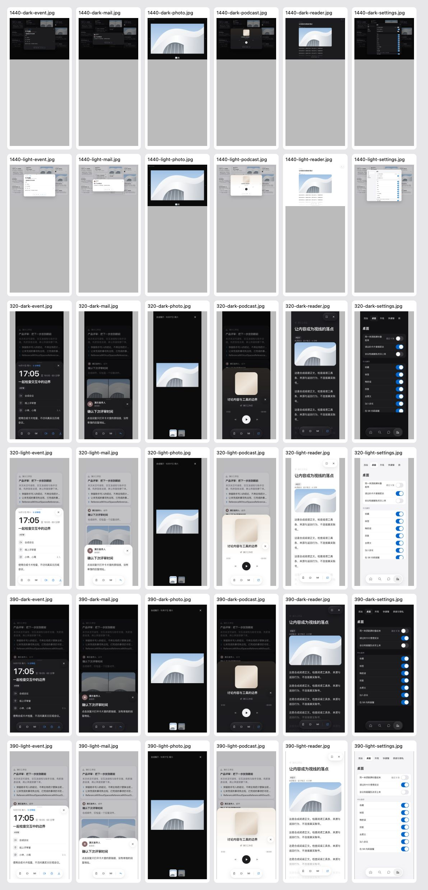

# 卡片详情核对（U4）

日期：2026-10-19。提交 [PR #55](https://github.com/dabaige53/sill/pull/55)。基准 `a073721` 承接 C5 和 U1 的最新本地画板。本次只核对与记录，不改产品代码、设计规则、组件包或图标；Mac 未改。

## 结论

| 项目 | 依据与实际结果 | 状态 |
| --- | --- | --- |
| U4.1 日程第四个操作 | 快开始且有会议链接时，依次显示加入、在 Sill 内再提醒、下载日程；忽略此提醒被截掉。与 ADR 0037 的已知代价一致。 | 等用户确认是否调整优先级；本轮不改。 |
| U4.2 邮件回复 | 一个「回复」按钮使用 `external` 动作，打开卡片 `url`。卡片约定只有通用 `url`，没有独立回复地址字段；不新增第二个相同行为的入口。 | 核对完成；以后有独立回复地址时另议。 |
| U4.3 播客 | 胶囊左侧收藏、标签、稍后读为 ink；竖线右侧去播客应用为 accent。三个播放控件仍在播放器内。 | 分组核对完成；是否调整播放控件需另行确认。 |
| U4.3 照片 | `Panels.lightbox` 只有关闭、前后照片、缩略图和可选宿主交接；没有收藏、标签、稍后读的胶囊。 | 与通用操作规则有差异，等用户确认，不直接套用或修改。 |
| U4.4 阅读页 | 底部复用同一胶囊；右上仍为已有的两个玻璃按钮，分别退出全屏和关闭阅读。 | 核对完成；外观讨论列入 U6，本轮不改。 |
| U4.5 卡片操作设置 | 九行开关均有动作名称，没有逐行列受影响的卡片类型。 | 等用户确认是否添加类型示例；本轮不加文案或编辑器。 |

依据：[ADR 0037](../../adr/0037-card-detail-toolbar.md)、设计手册的预览与叠放、`contracts/card.ts`、`contracts/card-actions.ts`、`apps/web/interactions/panels.ts`、`previews.ts`、`views/actions/external.ts`。日程截断属于既定规则；照片缺少通用操作属于本次确认的差异。两者均未改实现。

## 实际页面

在隔离的 localhost 页面中注入合成卡片，不读取本机工作区或真实账号。Chromium 使用预装路径，固定合成时间与 Asia/Shanghai 时区。320、390、1440 三种宽度，浅色与深色各六页，共 36 张截图；未注入提案样式。

原图按 `<宽度>-<light 或 dark>-<页面>.jpg` 命名。页面为 mail、event、photo、podcast、reader、settings。例如：[照片 390](390-light-photo.jpg)、[播客 320](320-light-podcast.jpg)、[日程 390](390-light-event.jpg)、[阅读 1440](1440-light-reader.jpg)、[设置 320](320-light-settings.jpg)。逐页动作名称、分组、颜色及按钮位置见 [页面观测](audit.json)。

本次没有改界面，因此没有伪造「改后」图片。截图是当前实现的证据；确认后的变更仍须另补前后对照。

## 检查与限制

合并基准 `npm test` 通过：共享约定 36、Web 192、服务端 92，失败 0，含 `files:check`。相关抽屉浏览器 11 项通过。36 页截图没有页面异常或外部请求。Web lint 为 0 错误、515 警告、30 条提示；文案键 826 个，哈希键 491 个、panels 哈希键 0 个；图标 69 个。日志摘要与哈希见 [检查](checks.json)。最终提交检查与 CI 以 PR Evidence 为准。

没有新增测试：现有 `detail-toolbar.test.ts` 覆盖邮件单一回复、分组、隐藏操作，`panels.test.ts` 覆盖卡片类型与播客内容，`agent-handoff.test.ts` 覆盖阅读和照片页交接；本次不修改这些行为，也不把已知设计差异写成通过断言。

真机、Safari 未检查。云端生产页面与真实宿主未检查。没有访问线上 Design System 或画布，`design-system/design-system.json` 未改。U4 没有新增线上未同步文件；合入的 U1 本地画板及截图仍按 [U1 记录](../2026-10-18-pwa-board/README.md) 由用户处理。
