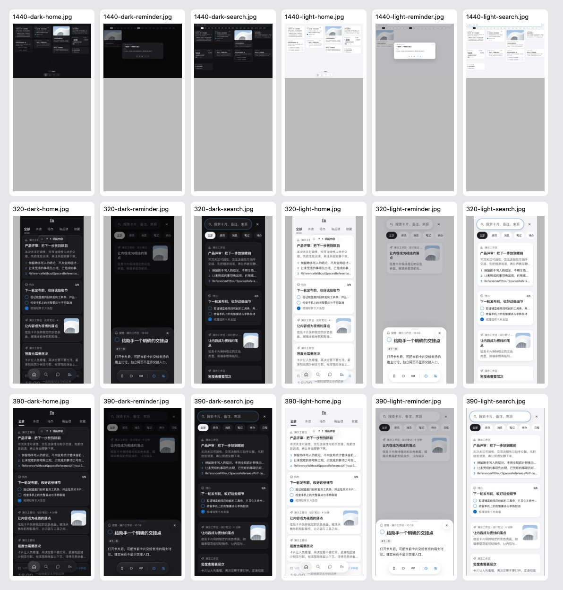

# 桌面与手机一致性核对（U5）

日期：2026-10-19。提交 [PR #56](https://github.com/dabaige53/sill/pull/56)，基准 `46565cf`。只核对 Web 的桌面与手机布局，不改界面、文案、状态或设计规则；Mac 未改，原生端视觉未检查。

## 结果

| 项目 | 实际结果 |
| --- | --- |
| 相同称呼 | 主页与搜索的「全部、未读、收藏、稍后读」逐项一致，复用同一组文案键。 |
| 卡片名称 | 同一卡片在主页和搜索中使用相同的无障碍名称；两处复用 `cardHTML`。 |
| 状态 | 主页已有收藏、稍后读状态在搜索中保留；两处共用同一卡片状态，没有另存一份。 |
| 筛选 | 在搜索中切换收藏筛选后，主页筛选对象保持原值；没有把搜索条件带回主页。 |
| 颜色角色 | 同一主题内，ink、muted、secondary、accent、alert、card、canvas 在主页和搜索中一致；标题、元信息与操作继续使用原角色。深浅色的具体值不同，不要求数值相同。 |
| 提醒语义 | 详情仍写「完成」「在 Sill 内再提醒」。点完成只改变 Sill 状态，卡片原始内容及到期时间逐字不变；返回搜索后重新打开，按钮写「恢复」。没有请求外部来源。 |
| 预期布局差异 | 320、390 显示手机顶栏与五个分栏；1440 不显示顶栏。桌面是否添加分栏仍等用户确认，不能因一致性核对直接加上。 |

三种宽度和两种主题共六组均完成这些核对，没有检出需要直接修复的文案或状态差异。这里的结果不代表 U6 的搜索、设置或深色设计已定稿。

## 实际页面与观测

原图按 `<宽度>-<light 或 dark>-<home、search、reminder>.jpg` 命名。例如：[390 手机主页](390-light-home.jpg)、[1440 桌面主页](1440-light-home.jpg)、[320 深色搜索](320-dark-search.jpg)。设置页现状复用 [U4 截图](../2026-10-19-card-detail-audit/README.md)，不重复保存同图。

[页面观测](audit.json) 保留各组合的实际文案、颜色变量、共享状态和动作结果。全部使用 localhost 隔离页面、合成卡片与固定时间，不读取真实工作区、不导出浏览器存储；页面异常与外部请求均为 0。没有实现改动，因此只有现状图，不制造前后差异。

最初的临时观测脚本错误假定完成后仍能读取详情里的恢复按钮，后又错误等待整个对话框关闭。这两次失败都先在基础提交 `a073721` 复跑，分别得到同一断言失败与超时。实际流程是关闭详情并恢复搜索页；修正观测步骤为等待返回搜索、再重新打开详情后，原有完成、恢复及来源内容不变的断言全部通过。没有改产品、仓库测试或放宽断言。原始结果分别保存在 [首次观测失败](observation-initial.log)、[基础同样失败](observation-base.log)、[第二次等待超时](observation-timeout.log)、[基础同样超时](observation-timeout-base.log)、[修正步骤后六组结果](observation-corrected.log)。

## 检查与交付边界

基准的 `npm test` 为共享约定 36、Web 192、服务端 92，失败 0。最终文档提交后再次运行完整 Node 与相关密度、搜索浏览器检查，结果以 PR Evidence 为准。[检查汇总](checks.json) 记录基准与观测结果；Web lint 为 0 错误、515 警告、30 条提示，文案键 826（哈希 491、panels 哈希 0），图标 69。

桌面分栏方案尚未准备，需按交接文档补公开参考和真实页面效果图，取得用户选择后再实施。本轮不改设计手册、组件、图标、画板、文案文件或 `design-system/design-system.json`，没有新增线上未同步文件。更早工作包的未同步清单继续有效。本机真机、Safari 和生产页面未检查；未访问 claude.ai 工具、线上 Design System 或设计画布。
