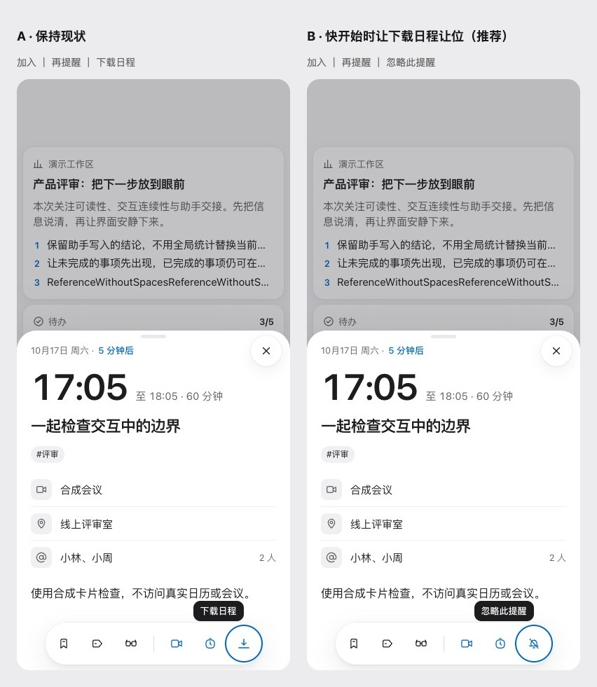

# 日程专属操作优先级（U4.1）

2026-10-19。用户查看 320 / 390 / 1440、浅色与深色实际页面临时效果后，选择「B：换成忽略此提醒」。显示「加入」时，第三个专属操作优先忽略提醒；下载保留为隐藏其他操作后的补位项。没有显示加入时保持原顺序。先写 [ADR 0040](../../adr/0040-event-reminder-priority.md)、手册和 Dialog 说明，再补回归与实现。

公开参考：[Apple 日历](https://support.apple.com/en-ca/guide/iphone/iphdafdf98a1/27/ios/27)、[Google Meet / Calendar](https://support.google.com/meet/answer/9303069?hl=en-IN)、[Fantastical](https://flexibits.com/fantastical/help/settings)。这些链接作为成熟产品的入口与提醒取舍参考，不复制产品资产。

方案 A 保留加入、再提醒、下载；方案 B 用既有忽略图标替代第三位下载。临时方案仅修改隔离页面 DOM，不改产品源文件。实现后另截实际页面，不能把临时方案当成改后证据。只用合成卡片，不包含账号、token 或浏览器存储。最终截图、检查与线上未同步清单随本包 PR 补齐。Mac 未改；真机与 Safari 未检查。

## 实施与证据

[改前 6 组观测](before.json) 来自 `66884d0`，原第三项为下载；[改后 6 组观测](after.json) 来自 `2c295b7`，第三项为忽略。320 / 390 / 1440、浅色与深色实际截图已补入 [37 号画板](../../../design-system/boards/CardDetail.dc.html)，没有临时修改页面。六组真实点击均确认 dismissed 为 true、来源卡片与时间逐字不变，无页面异常和外部请求。

新增回归在原实现上 [4 通过 / 1 失败](regression-before.log)，实施后 [5/5 通过](regression-after.log)，覆盖无加入、快开始、无会议链接及隐藏忽略/再提醒后的下载补位。原下载用例改为明确一小时后开始，保留原断言，避免测试跟随实际时钟漂移。没有修改 window.__app、提醒处理、来源链接或时间条件。生成器重建 69 图标，组件包与图标没有差异。

源码提交 `80cf4f1` 的完整检查发现新测试数组被推断为 string[]，[类型失败](fixture-type-failure.log) 已保留；`2c295b7` 改用共享 CardAction 类型，完整检查通过：共享约定 36 / Web 193 / 服务端 92，失败 0，包含 files:check。PWA 10/10。抽屉首次 [10 通过 / 1 失败](drawer.log)，在 `66884d0` 基础运行时 [11/11 通过](drawer-base.log)，恢复当前实现后 [11/11 通过](drawer-repeat.log)；失败点为固定等待后读取导航淡入中间值，未确认根因，没有改断言、禁用测试或增加等待。该失败未在基础复现，不能声称基础也失败。

Web 目录 lint 为 0 错误、515 警告、30 提示；npm run lint:web 实际扫描全仓，结果为 0 错误、1542 警告、298 提示，两者范围不同。文案仍 826 键（哈希 491、panels 哈希 0），图标 69。见 [检查摘要](checks.json)。画板 23 张图片全部加载，无异常、外部请求或裁切，[实际高 5808.75px](board-render.json)、元数据 5810px，[与其他画板不重叠](canvas-check.json)。

ADR 0040、手册、Dialog 说明、37 号画板及新增六张图片、索引与 canvas.json 线上未同步，逐项列在 PR #55。design-system/design-system.json 未改。照片通用操作与 U4.5 设置示例仍等用户决定；本次不代替这些决定。最终证据提交后的检查与 CI 以 PR Evidence 为准。
