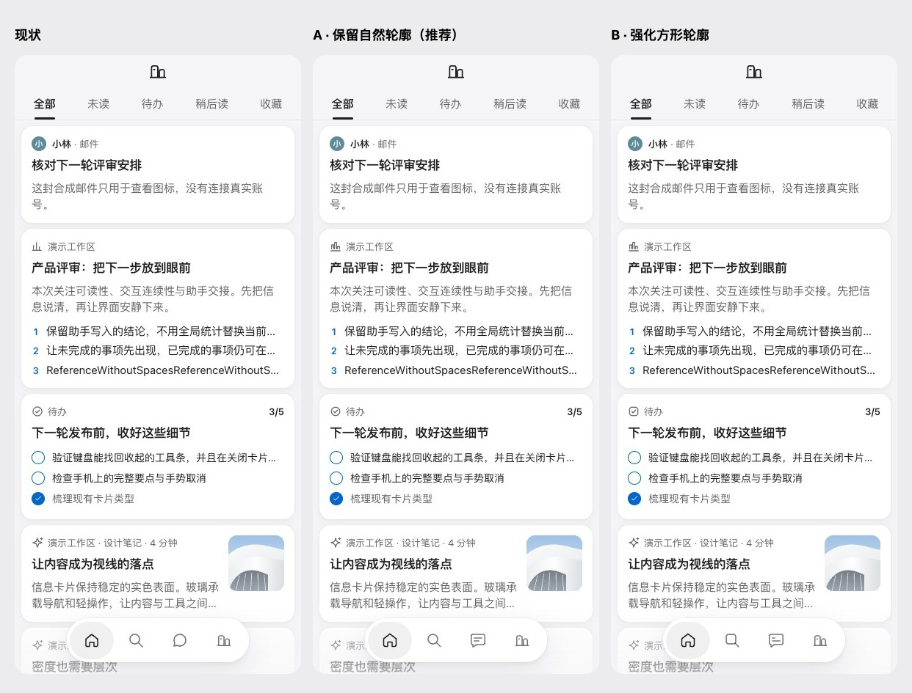

# 图标比较：保留原版（U2）

日期：2026-10-19。提交 [PR #57](https://github.com/dabaige53/sill/pull/57)，承接 `8c39bd5`。本次用户选择保留现状，不是实施新的图标套装；Mac 未改。

## 用户决定

用户查看全部 69 个图标在三档尺寸、浅色与深色下的现状、A、B，以及真实页面临时替换效果后回复：

> 原版更优秀！

因此保留 `icons.ts` 当前全部路径与三档线宽，取消继续重画约 60 个图标的待办。原有九个已确认的线条积木图标也保留，不撤回 ADR 0037。已写 [ADR 0038](../../adr/0038-keep-original-icons.md)，更新手册与 IconButton 说明；A/B 留作已否决的讨论证据，不进入产品、组件包或当前画板。

## 实际对照

| 方案 | 提案内容 | 决定 |
| --- | --- | --- |
| 原版 | 当前 69 个图标及其含义、线宽、轮廓。 | 保留。 |
| A | 46 个候选调整；保留常见圆形轮廓，其余改圆角积木。另 23 个保留，包括已确认九个、品牌标志和基础符号。 | 不采用。 |
| B | 同样 46 个候选调整，更多圆形改为方圆形。 | 不采用。 |

[深色页面对照](page-compare-dark.jpg)、[常用图标对照](icons-focus.jpg)、[全部 69 个图标：16 / 20 / 24px、浅色与深色](icons-all.jpg)。[HTML 对照源](icons-all.html) 与 [候选路径](proposals.json) 仅为讨论证据，不是产品配置。

截图来自隔离 localhost 的真实 Web 页面，使用合成内容。320 / 390 / 1440、两种主题、现状与两套提案，共 18 张。候选只临时替换页面中识别到的 SVG 路径，尺寸、布局、导航镜片和交互保持原值；现状截图没有候选替换。六张现状图保存在本地画板的 `design-system/boards/icon-set/`，不在记录中重复保存；12 张候选原图在本目录中按宽度、主题、方案命名。见 [截图元数据](captures.json)。

公开参考于本次读取确认可访问，仅作符号识别与密度对照，不复制产品资产：

- [Apple Notes](https://support.apple.com/en-gb/guide/iphone/iph9e04f3be2/27/ios/27)：常见动作与按钮含义。
- [X 收藏](https://help.x.com/en/using-x/bookmarks)：收藏动作与图标含义。
- [Things](https://culturedcode.com/things/features/)：任务与轻操作的表达。
- [Linear](https://linear.app/features)：紧凑信息中的符号使用。

## 检查

候选渲染包含 69 行、1242 个 SVG，几何均在 24×24 viewBox 内；18 张实际页面截图的异常与外部请求均为 0。这些检查只验证提案能显示，不表示提案获准。见 [几何检查](validation.json)、[候选范围](scope.json)。

按用户选择更新规范后，已运行既有生成器。69 个图标、图标源、组件包、原品牌 PNG、manifest 和线上资产记录共 75 个源文件与资产逐字不变，见 [不变性检查](unchanged.json)。没有把重新运行生成器说成更换图标。新建本地 38 号画板，展示完整原版图标与六张实际页面截图，更新索引和 canvas.json；[实际渲染](board.jpg) 包含 414 个图标实例、六张图片，无页面异常或外部请求。画板实际高 4942.36px，元数据 4960px，无裁切；[位置检查](canvas-check.json) 确认不与既有画板重叠。

提交 `25027b0` 后 `npm test` 通过：共享约定 36、Web 192、服务端 92，失败 0，包含 `files:check`；PWA 触控与键盘浏览器 10/10、`npm run lint:web` 通过。见 [检查汇总](checks.json)。后续仅补检查结果并移除本次误存的同一张重复画板截图，最终提交检查与 CI 以 PR Evidence 为准。没有产品代码或视觉变化，不新增重复实现的测试，也不伪造改后截图。

## 边界与未检查项

这次决定包含当前导航四个图标的绘法，但不决定 U3 的镜片与当前项状态。品牌 PNG、manifest 图标尺寸与 maskable 不因本次决定重画或替换；用户的回复不能解释为批准新的安装资产。真机、Safari 未检查，安装状态沿用 U1 的检查边界。

没有访问或发布线上 Design System、画布或 Artifact，没有使用 claude.ai / Mobbin 连接器。`design-system/design-system.json` 未改。本次手册、IconButton 说明、本地 38 号画板及六张现状图、索引和 canvas.json 线上未同步，由用户处理，完整清单见 PR Merge Danger。
