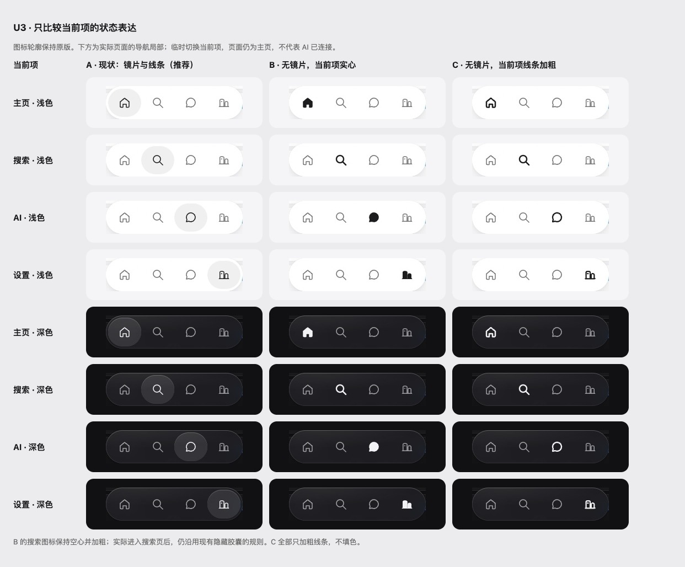

# 导航当前项：保留镜片（U3）

日期：2026-10-19。提交 [PR #58](https://github.com/dabaige53/sill/pull/58)，基准 `a342700`。用户选择 A，保留现状镜片和原版四个图标，不改导航实现；Mac 未改。

## 用户决定

用户查看三套真实页面临时效果、浅色与深色的四种当前项后，选择：

> A：保留现状镜片（推荐）

| 方案 | 表达 | 决定 |
| --- | --- | --- |
| A | 原有玻璃镜片、原版线条图标和既有当前页标记。 | 保留。 |
| B | 去镜片，当前项实心；搜索保持空心加粗。 | 不采用。 |
| C | 去镜片，当前项加粗线条。 | 不采用。 |

写入 [ADR 0039](../../adr/0039-keep-navigation-lens.md)。不把镜片问题继续列为未定，不重画 AI 或设置图标，不改变搜索隐藏胶囊、手机 AI/设置页面保留胶囊、桌面打开面板时让开的规则。

## 对照与公开参考

[完整页面对照](page-compare.jpg)。三种宽度 320 / 390 / 1440、两种主题、三套方案，共 18 张全页截图；390 下另有四种当前项的 24 张导航局部。来自隔离 localhost 真实页面，只使用合成卡片。B/C 由临时样式实现，未改源文件；导航局部是在同一主页上临时切换当前项，明确不是打开 AI 或完成外部连接的证据。见 [观测元数据](captures.json)。

另外通过真实点击打开手机 AI、设置页，浅色与深色四组的 `aria-current` 均与页面相符，没有临时修改页面。完整截图与选定的 A 保存在本地画板的 `navigation-state/`；[页面观测](pages.json) 保留结果。实际进入搜索后仍隐藏胶囊，因此搜索局部只用于比较切换状态，不表示搜索页始终显示导航。

公开参考均在本次读取确认可访问，不下载或分发产品资产：

- [Apple Music](https://www.apple.com/apple-music/)
- [Apple Podcasts](https://www.apple.com/apple-podcasts/)
- [X for iOS](https://help.x.com/en/using-x/x-ios-app)
- [Things](https://culturedcode.com/things/features/)

## 文档与检查

先写 ADR、更新手册与 GlassDock 说明。该组件旧文档仍写设置显示头像、AI 没有输入框，以及搜索始终保留胶囊；现行手册、产品边界与代码已经采用 Sill 标志、本地不可发送草稿及独立搜索页。本次只补准说明，不增加能力或改页面。用户可见文字仍取既有文案文件。

按既有生成器重建并核对图标和组件包，不采用 B/C，也不修改导航实现。新增本地 39 号画板，展示选定状态与实际页面，并更新索引和 canvas.json。最终 Node、相关浏览器、产物不变性与本地渲染结果以 PR Evidence 为准；不能把规范确认写成新功能上线。

本轮没有设计代码变化，不新增重复实现的测试；沿用 Node 中的 chrome、导航与状态检查，以及 PWA 触控、动效浏览器检查。真机、Safari 未检查。手册、GlassDock 说明、本地画板和图片线上未同步，逐项列在 PR Merge Danger，由用户处理；`design-system/design-system.json` 未改，未访问 claude.ai 工具、线上 Design System 或画布。
