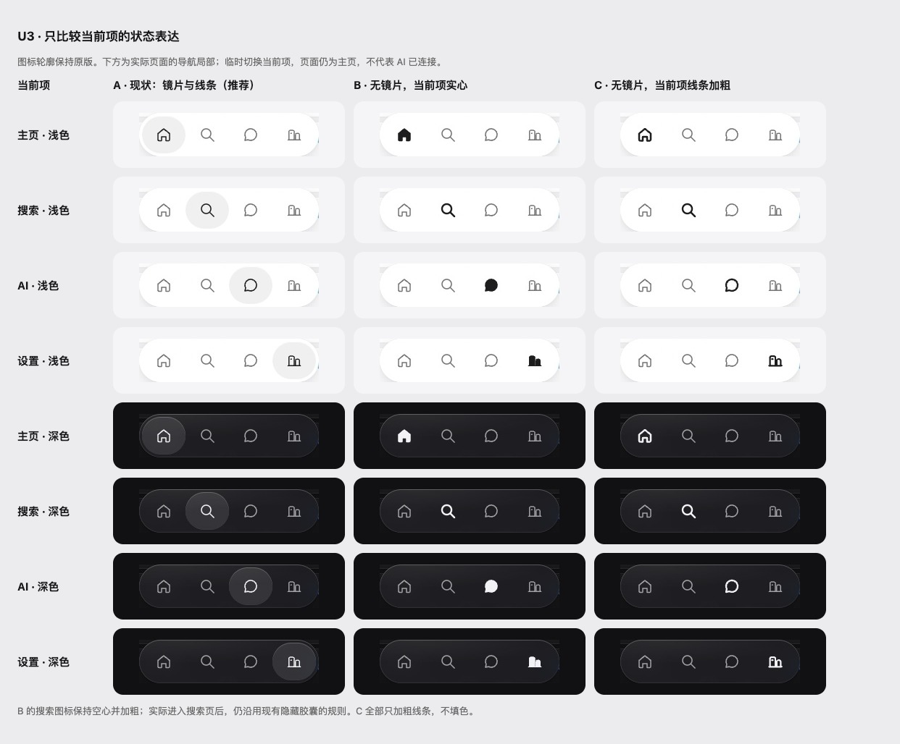

# 导航当前项：保留镜片（U3）

日期：2026-10-19。提交 [PR #58](https://github.com/dabaige53/sill/pull/58)，基准 `a342700`。用户选择 A，保留现状镜片和原版四个图标，不改导航实现；Mac 未改。

## 用户决定

用户查看三套真实页面临时效果、浅色与深色的四种当前项后，选择：

> A：保留现状镜片（推荐）

| 方案 | 表达 | 决定 |
| --- | --- | --- |
| A | 原有玻璃镜片、原版线条图标和既有当前页标记。 | 保留。 |
| B | 去镜片，当前项实心；搜索保持空心加粗。 | 不采用。 |
| C | 去镜片，当前项加粗线条。 | 不采用。 |

## 对照与公开参考

[完整页面对照](page-compare.jpg)。三种宽度 320 / 390 / 1440、两种主题、三套方案，共 18 张全页截图；390 下另有四种当前项的 24 张导航局部。来自隔离 localhost 真实页面，只使用合成卡片。B/C 由临时样式实现，未改源文件；导航局部是在同一主页上临时切换当前项，明确不是打开 AI 或完成外部连接的证据。见 [观测元数据](captures.json)。

公开参考均在本次读取确认可访问，不下载或分发产品资产：

- [Apple Music](https://www.apple.com/apple-music/)
- [Apple Podcasts](https://www.apple.com/apple-podcasts/)
- [X for iOS](https://help.x.com/en/using-x/x-ios-app)
- [Things](https://culturedcode.com/things/features/)

## 文档与检查

先写 ADR、更新手册与 GlassDock 说明。该组件旧文档仍写设置显示头像、AI 没有输入框，以及搜索始终保留胶囊；现行手册、产品边界与代码已经采用 Sill 标志、本地不可发送草稿及独立搜索页。本次只补准说明，不增加能力或改页面。用户可见文字仍取既有文案文件。

提交 `b210c35` 后 `npm test` 通过：共享约定 36、Web 192、服务端 92，失败 0，包含 `files:check`；相关动效浏览器 17/17、PWA 触控与键盘 10/10 通过。原图标、AppController、导航样式、组件 JS/CSS 和线上资产记录逐字不变，见 [不变性检查](unchanged.json)。本地画板 18 张图片全部解码，无页面异常、失败资源或外部请求，实际高 3814.72px、元数据 3820px，无裁切或与旧画板重叠，见 [渲染](board-render.json) 与 [位置](canvas-check.json)。
