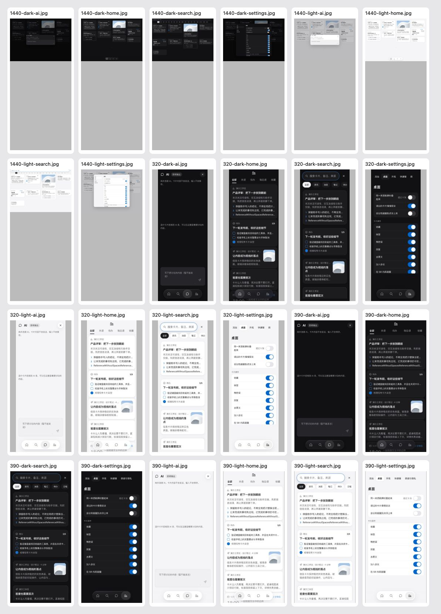

# 搜索、AI、设置与深色现状（U6）

2026-10-19，基准 `71b809c`，提交 [PR #59](https://github.com/dabaige53/sill/pull/59)。只记录现状，不替用户决定设计，不改界面、文案、图标、行为或生成包。Mac 未改。

## 实际页面

320 / 390 / 1440、浅色与深色，分别通过真实导航打开主页、搜索、AI、设置，共 24 张截图。只使用合成卡片，隔离 localhost，禁止外部请求；没有真实账号、token 或浏览器存储导出。见 [观测](audit.json)。所有页面无横向溢出，弹层无横向溢出，页面异常与外部请求为 0。这些结果不代表真机、Safari 或生产验收。

- 搜索：两端是独立搜索页，导航隐藏；关闭后返回主页。文字筛选、分组结果和独立搜索状态仍按原实现。布局与筛选密度待用户选定。
- AI：输入框是本地草稿，发送按钮保持禁用，名称明确写「尚未连接 AI」。不新增助手、模型、连接器或外部来源。手机当前有关闭按钮，同时保留底部胶囊，与手册“手机页面没有关闭按钮”有差异；不得在本次审计中默认批准或移除。
- 设置：手机整页保留胶囊，桌面面板隐藏导航并提供关闭按钮。整体分组仍待讨论；U4.5 的卡片类型示例属于单独待确认项。
- 深色：主页、搜索、AI、设置均取各自浅/深色变量角色。照片固定黑底属于原有页面规则。当前只是收集两种主题现状，不能据此声称用户已批准整体深色方案；阅读顶部旧工具组一起留在 U6 讨论。

## 待用户决定

每次只处理一个问题：搜索 → AI → 设置整体 → 深色整体。先补 3–6 个公开成熟产品参考，再在真实页面叠临时样式比较 2–3 套方案。用户选定后才写 ADR、手册、组件规则并实施、生成、更新本地画板与线上未同步清单。本轮没有提出或实施这些候选；目前先处理 U4 照片通用操作，不同时发出第二个问题。

## 检查边界

24 组页面观测通过，文件均小于 2 MB。最终 Node、相关浏览器和 CI 以本包 PR Evidence 为准。没有设计实现变更，不新增重复实现的测试。本包没有新增线上未同步设计文件，前序 PR 的清单继续有效。真机、Safari、Mac 原生视觉未检查；本机没有 Docker，Postgres 本地检查未执行，C6 的真实 Postgres CI 结果另见对应记录。没有部署。

提交 `0cd569e` 后 npm test 三组 36 / 193 / 92、失败 0，包含 files:check；搜索浏览器 2/2。产品运行时与 `71b809c` 一致。Web 目录 lint 0 错误、515 警告、30 提示，文案 826 键（哈希 491、panels 哈希 0），图标 69。后续证据提交结果以 PR Evidence 为准。
