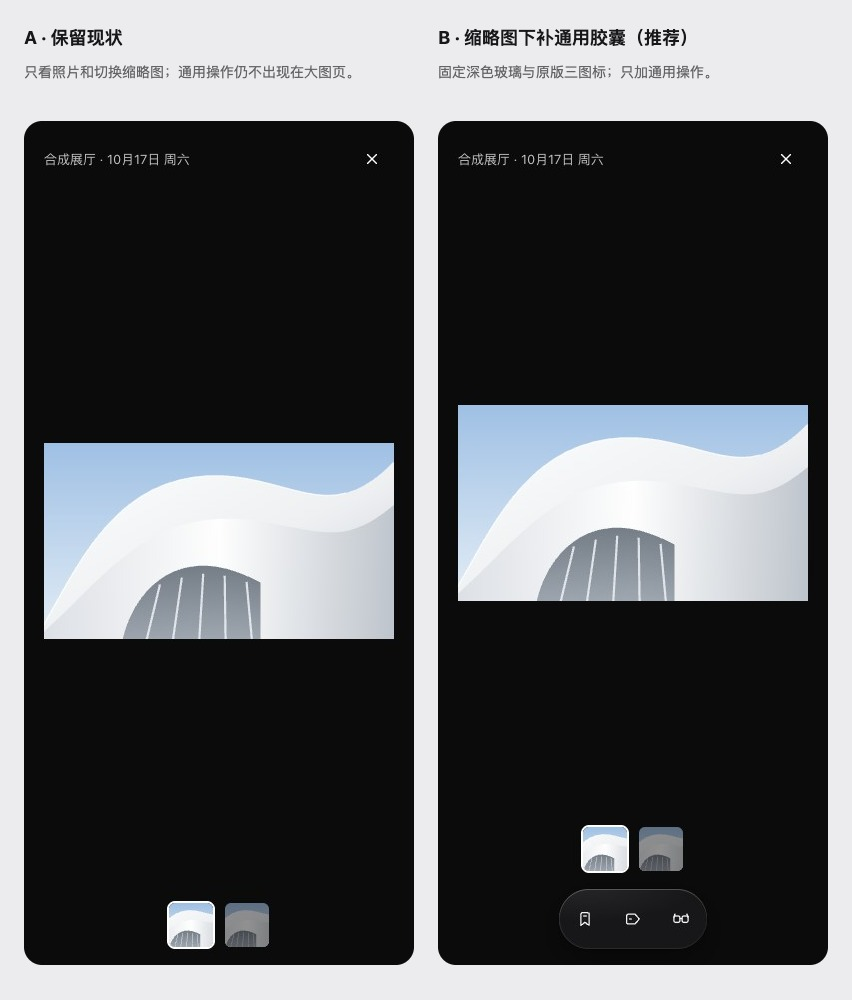

# 照片大图页补通用操作（U4）

2026-10-19。用户比较真实页面的 A 保留现状与 B 缩略图下补胶囊后，选择「B：补通用操作胶囊」。先写 [ADR 0041](../../adr/0041-photo-shared-toolbar.md)、设计手册与 Dialog 说明，再补回归并实施。不新增复杂编辑器、更多菜单、专属动作或外部来源。Mac 未改。

候选来自隔离 localhost 的真实大图页，只含合成照片。320 / 390 / 1440、浅色与深色共 12 张；B 只注入现有工具条 HTML、既有深色变量和临时样式，产品源文件未改。用户选定后另截实际实现，不把临时方案当成改后证据。

公开参考：[Apple 照片](https://support.apple.com/en-ie/guide/iphone/iph3d267610/ios)、[Google Photos](https://support.google.com/photos/answer/6220402?hl=en)、[Lightroom](https://www.adobe.com/learn/lightroom-cc/web/use-ratings-flags-to-find-photos-lightroom-mobile)。仅参考看图时的工具与整理入口，不复制资产、不接入产品。

最终前后截图、测试和本地画板结果随本包 PR 补齐。真机与 Safari 未检查；线上资产记录不改，线上未同步文件列入 PR #55，由用户另行处理。

## 用户选择与前后证据

用户选择 B。A 为真实改前页面，B 仅为临时候选；[候选观测](proposals.json) 覆盖三个宽度和两种主题。[真实改后观测](after.json) 没有临时样式，六张图位于 [40 号画板](../../../design-system/boards/PhotoTools.dc.html)。使用与改前相同的卡片、时间和照片，照片没有被胶囊覆盖，缩略图保留。

先补 [通用操作缺失回归](toolbar-before.log) 与 [标签返回回归](tags-return-before.log)，两者在原实现失败；实施后 [16/16 相关单元测试](unit-after.log) 通过。新浏览器检查先在 `5bab314` 基础完整运行时复跑，[原页没有工具条而失败](browser-base.log)。当前实现最初在进入动画尚未结束时读取布局，[坐标观测](browser-measurement.log) 显示底部暂时越界；现有 MotionEngine 会分别让弹层和工具条从 translateY(10px) 进入。检查改为等待实际动画 finished 后测量，[全部场景通过](browser-settled.log)，原边界断言不变，没有增加固定等待、跳过或禁用。

收藏与稍后读复用既有个人状态处理；标签保存和取消返回原照片索引，不改变其他类型面板的返回规则。三种宽度、浅深色六组真实点击确认：来源卡片逐字不变、收藏状态翻图后保留、标签写入和取消正确、全隐藏无空栏、减少透明度使用深色实底。生成组件 CSS 在浅色宿主也保留照片深色环境，见 [浏览器结果](browser-checks.json)。

## 检查与同步

`1e652ba` 后 npm test：共享约定 36 / Web 195 / 服务端 92，失败 0，包含 files:check；照片浏览器 6 场景 + 组件包 1 项通过；云端 MCP App 浏览器 1/1，包含照片翻页后的交接恢复提示，未新增直接网络或存储。新照片浏览器已接入 Verify CI。预检查发现新测试照片数组类型及导入排序问题，已用 Card 类型和既有排序修正；最终提交复查以 PR 为准。

运行生成器，仍有 69 个原版图标；只更新组件 CSS 的深色上下文与照片工具条排版。源文件使用已有深色变量块，组件包由同一块生成，没有复制另一套颜色或修改 token 数值。样式选择器与既有 #modal 形态保持一致，Web lint 仍为 0 错误、515 警告、30 提示。文案仍 826 键（哈希 491、panels 哈希 0）。window.__app 的方法与参数不变，Mac/iOS 原生未改。

本地画板六张图片全部解码，无页面异常、失败资源或外部请求；[实际高度 1834.17px](board-render.json)、[元数据 1840px 且无重叠](canvas-check.json)。所有证据文件小于 2 MB，没有真实账号或存储导出。真机与 Safari 未检查。

ADR 0041、手册、Dialog 说明、深色上下文与工具条样式来源、组件 CSS、40 号画板与六张实际截图、索引及 canvas.json 线上未同步，列入原 PR #55。生成脚本只在仓库更新；没有访问、读取或发布线上 Design System、claude.ai 画布或 Mobbin，design-system/design-system.json 不变。U4.5 设置示例继续先出方案、等用户选择。
