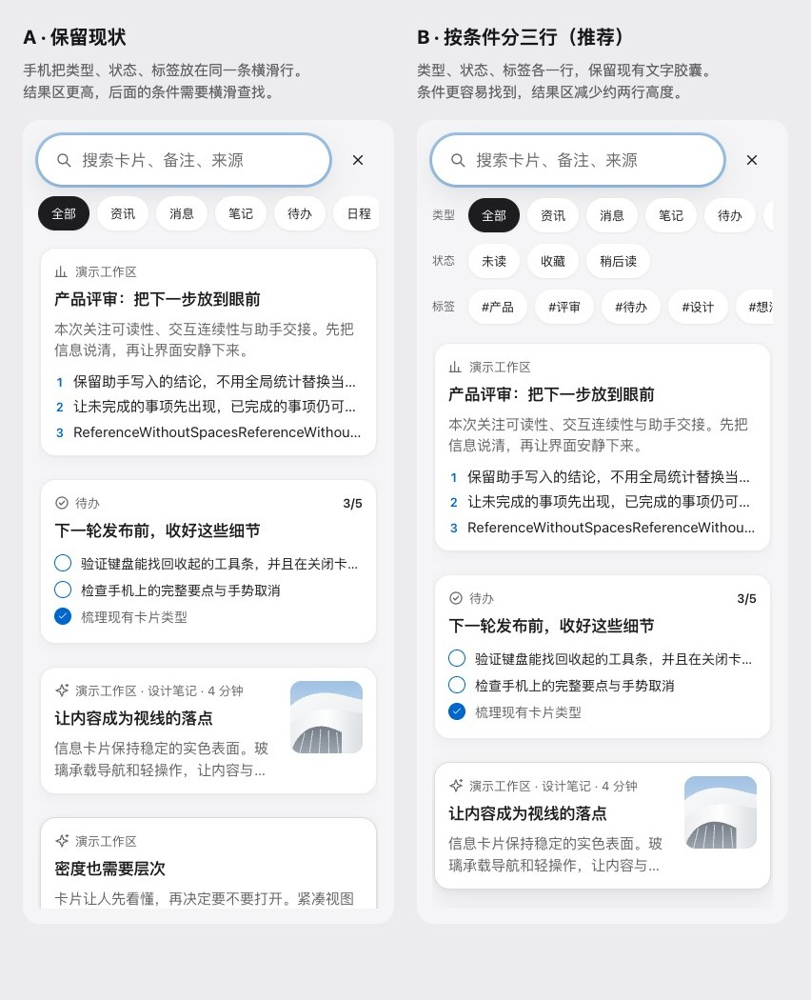

# 搜索筛选排布候选（U6）

2026-10-19，实际页面基准 `7d5e1fe`。用户已收到对比，正在等待选择。本记录只保存候选，不把 B 推荐当成批准；没有新增 ADR 或修改搜索实现、文案、组件包及画板。Mac 未改。

A 保留现状：手机将类型、状态、标签排在一条横滑行里，结果区较高；后面的条件需要横滑寻找。桌面仍为原有居中换行。

B 按条件分三行（推荐）：类型、状态、标签各占一行，组内横滑。保留现有文字胶囊、顺序、选中状态和筛选处理。状态与标签更容易找到，手机结果区少约两行高度。不使用图标加文字、更多菜单、通栏标签栏或通栏列表。

## 公开参考

- [Apple Mail 搜索](https://support.apple.com/en-gb/guide/iphone/iphb2eab8035/ios)：搜索文字与限定条件可分开使用。
- [X 搜索](https://help.x.com/en/using-x/x-search)：结果类型与其他筛选分别表达。
- [Things Quick Find](https://culturedcode.com/things/support/articles/2803584/)：输入即缩小结果，标签参与查找。

2026-10-19 已打开以上官方公开页面。这里只借鉴层次，不复制资产，不接入外部来源，不访问 Mobbin 或线上 Design System。

## 实际页面与边界

[320 浅色](compare-320-light.jpg)、[320 深色](compare-320-dark.jpg)、[390 深色](compare-390-dark.jpg)、[1440 A](1440-light-a.jpg)、[1440 B](1440-light-b.jpg)。目录保存三种宽度、浅深两种主题、两套排布共 12 张完整截图；[元数据](captures.json) 列出来源、位置和按钮。

A 没有临时样式。B 在真实页面移动原按钮到临时分组，再叠 CSS；所有原按钮的文字、动作、状态与顺序逐项一致，搜索结果不变。使用合成卡片，隔离 localhost，禁止外部请求；12 组没有页面异常、页面或弹层横向溢出。无真实账号、token 或存储导出，单文件均小于 2 MB。这是候选观察，不代表交互、键盘或真机验收。

下一步必须等用户选择，再写 ADR、更新手册和组件规范、补测试、改实现、运行生成器与本地画板。AI、设置整体、深色及阅读顶部旧工具组继续留待单独讨论。真机、Safari、Mac 原生视觉未检查，没有部署。
