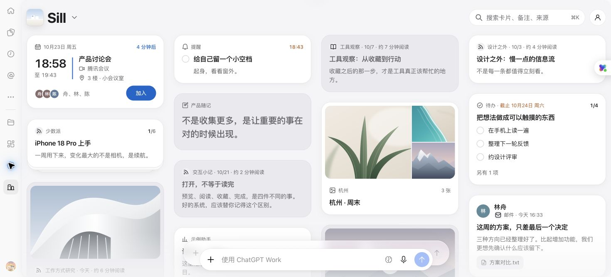

# MCP 工作台旧入口恢复

2026-10-23。用户反馈内嵌页面“未能显示 Sill · 窗台”。账号登录与 MCP 调用成功，不能证明页面资源可读或页面已经显示。

## 历史依据与本次原因

- [2026-10-15 接入记录](../2026-10-15-app-connection-build/README.md)分别检查 App 身份、OAuth、工具、资源和实际页面。
- [2026-10-16 成功发布记录](../2026-10-16-cloud-operations/README.md)沿用原 App，部署服务端后刷新工具，再验证真实宿主中的页面和读写。该次把页面地址改为随产品版本更新，以更新宿主缓存。
- 本次 Chrome 实际请求 `ui://sill/cloud-workspace-1.2.2.html`。服务端已是 1.2.7，只接受当前版本和 `cloud-workspace-v3.html`，因此宿主的页面资源接口返回 HTTP 404。授权的打开工具仍返回成功。

## 修复与发布

版本页面地址继续用于更新缓存；同一工作台的历史版本地址统一解析为当前页面，并返回请求的 URI。所有地址仍经过当前账号、scope 和工作区权限检查。没有重新创建 App、变更权限或修改用户卡片。

| 对象 | 结果 |
| --- | --- |
| 原 App | `asdk_app_6ad0d805d3e88191a1c8902cf66af046` |
| 原插件 | `plugin_asdk_app_6ad0d805d3e88191a1c8902cf66af046`；保留 USER / PRIVATE |
| Worker | `sill-web-preview`；保留 7 项现有绑定 |
| 部署 | `f4caaa4f-9069-4ff0-a798-55ec3f7bac5f` |
| Worker version | `a81b3dad-ff85-4ff0-bcea-4374eb097880`，100% |
| 部署时间 | 2026-10-23 18:44:07 +08:00 |

## 验证

- 同一回归在旧实现上失败：实际 1.2.2 地址返回 `Resource unavailable`，见 [失败输出](regression-before.txt)。修复后当前地址、1.2.2 地址和 v3 地址均返回页面；撤权后全部拒绝。
- `cloud-app.test.ts` 与 `supabase-mcp.test.ts` 共 4 项通过；类型检查、发布构建和两份修改代码的格式检查通过。
- 按诊断 hook 指定的 `diagnostics_backend.py --check` 执行 TypeScript LSP 复查：`server/cloud/mcp.ts` 和 `tests/server/cloud-app.test.ts` 均为 `passed`，无诊断。
- 修复后 Chrome 中旧地址请求返回 HTTP 200。首次仍显示失败界面，重试后成功；未确认有独立的脚本故障。
- 在原插件设置执行“刷新工具”，随后从原入口重新打开。宿主改为请求 `cloud-workspace-1.2.7.html`，返回 HTTP 200，并显示工作台；此轮重新打开未点击重试。
- MCP 以预期测试账号读取到 30 张已有卡片。界面显示同一批示例内容；本次没有新增、修改或删除卡片。
- 用户确认“强刷后就好了”。Chrome 页面保持打开，见下图。

本次验证的是资源恢复、权限边界和 Chrome 实际显示，不替代全量业务或 Mac 回归。代码保留在工作区；此前提交已被仓库文件大小 hook 阻止，未绕过该限制。
