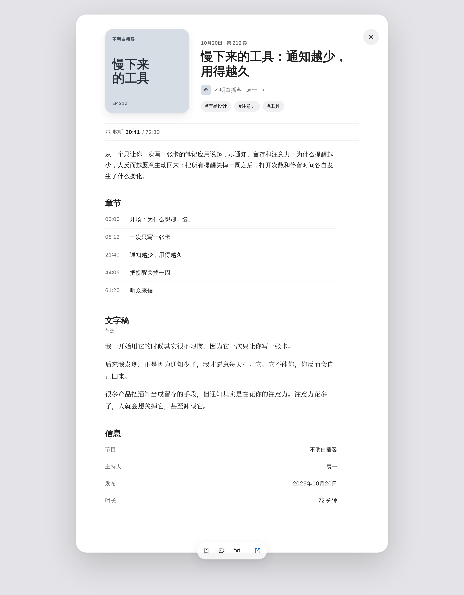
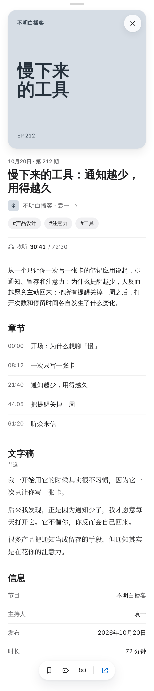

# 播客详情页原型：去掉播放，只做介绍

基准：`8fe1de0`（`main`）。本记录只保存设计原型，不改产品代码、设计变量、手册或现行画板。

## 用户要求

- 播客预览改为详情介绍页：不放播放按钮，不放 Tab，不提供全屏。
- 保留收听记录；播客不需要阅读时长。
- 收藏、标签、稍后读、去原文留在底部胶囊，与现有详情一致。
- 关闭在封面图片右上角，和图片之间不留一段空白。

## 原型内容

| 区域 | 内容 |
| --- | --- |
| 顶部 | 手机有抽屉把手；关闭不单占一行：手机浮在封面右上角，桌面与封面顶边对齐、靠抽屉右侧 |
| 头部 | 封面、日期与期数、标题、节目名与主持人、标签 |
| 收听记录 | 一行文字「收听 30:41 / 72:30」；不画进度条，章节也不标当前位置，位置只表达一次 |
| 正文 | 简介、章节（只读，不跳转）、文字稿节选、信息表（节目、主持人、发布、时长） |
| 底部胶囊 | 收藏、标签、稍后读，竖线后是 `accent` 色的去原文，按[卡片预览与叠放](../../../design-system/handbook/card-interaction.md#预览与叠放) |

版式参考 Apple Podcasts 单集页：大标题、节目行带「›」、章节与信息用分隔线列表、文字稿用衬线字体。

| 桌面 | 手机 |
| --- | --- |
|  |  |

## 文件

- `desktop.dc.html`、`mobile.dc.html`：画板源文件，格式为 Design 画布的 `.dc.html`。
- `desktop.png`、`mobile.png`：用 Playwright 本地渲染的截图，2 倍像素。
- 线上原型画布：[播客详情页原型](https://claude.ai/artifact/SPVJUexM7b8vZH3c1vUxy7)（私有）。

## 与现行规则的差异

- 现行规则是关闭按钮浮在来源行右侧，并且有全屏按钮。原型中关闭按钮对齐封面右上角（手机压在封面上），并去掉了全屏。
- 现行播客详情有播放器、吸顶播放条、文字稿跟随和章节跳转；原型全部去掉。
- 节目内容、时长和标签是示例数据。

## 未做

- 没有改 Web 或 macOS 代码，没有更新[界面对账表](../../implementation/design/ui-alignment.md)。
- 没有新增 ADR、现行画板或设计版本；没有发布 Sill Design System 或设计画布。
- 采用前需要确认：收听记录从哪里写入、去掉播放后 `playbackPosition` 是否只读，以及两端如何同步。
