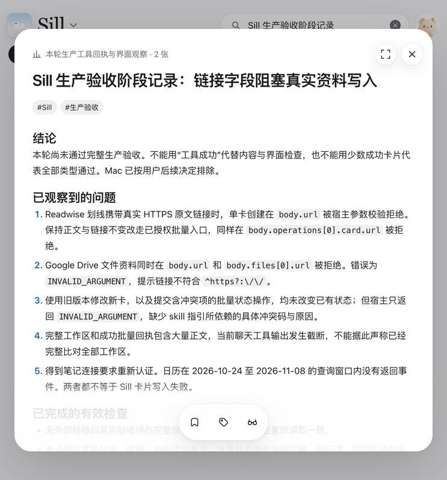

# 生产功能与扩展压力验收

日期：2026-10-31，Asia/Shanghai。结果：**失败**。本轮执行了生产实测，但没有完成全部类型和压力矩阵。Mac 按用户后续决定排除。

后续用户授权修复、发布和继续验收。云端 1.2.20 已发布，当前累计 41 次数据调用、4 张新卡；结构化冲突原因通过，HTTPS 写入仍失败。后续证据与修正集中维护在[修复与发布](release.md)，下文保留首轮 36 次调用的原始结论。

## 结果与边界

- 新增并保留 4 张真实卡片：1 张 Gmail 邮件，3 张来自本次真实要求、计划和观察的待办、引文、汇总。后者不算外部插件导入成果。
- 36 次显式 Sill 数据调用，30 次成功返回、6 次拒绝；另有 1 次 `open_workspace`。按最保守口径共 37 次 Sill 工具调用，低于 500 次上限。界面产生的内部请求没有伪装成已测得的工具调用。
- Readwise 单卡与批量创建、Google Drive 文件创建均在 HTTPS 结构字段被连接器校验拒绝。没有删链接、缩正文或使用示意数据换取成功。
- 标签、收藏、稍后读、备注、归档往返、任务子项、幂等重放和冲突原子性在新待办上取得有效证据。错误说明、完整工作区读取仍不满足 Agent 操作要求。
- 串行功能路径未通过，因此并发 3 和 5 均未开始。不能从本轮延迟推断生产容量。
- 原有卡片没有主动修改；外部来源仅只读。没有发送邮件、加入会议、修改任务或 GitHub、恢复备份、改权限、部署、提交或推送。

本轮问题正文见[流程与兼容性诊断](diagnosis.md)；URL 问题复用[卡片链接诊断](../2026-10-31-card-links/diagnosis.md#生产实测补充2026-10-31)，不另写一份。

用户随后授权修复、发布和继续测试；后续结果见[修复与发布](release.md)。本文保留首次验收的实际结果，不用候选代码覆盖生产失败证据。

## 环境与发现能力

入口为 Codex 内已连接的生产 Sill MCP 和插件工作台。已安装 skills 路径版本为 `1.2.19`，卡片协议为 `5.0.0`；未独立确认服务器实际部署提交。打开工作台回执为已连接，授权包含内容读、写、删除及工作区读写。没有使用删除权限。

初次发现工具数量过少是搜索返回数量限制，不足以证明缺失授权；扩大正常发现后得到 9 个工具。没有通过 CLI、数据库或私有接口绕过缺失能力。

| 能力 | 工具/路径 | 结果 | 证据及限制 |
| --- | --- | --- | --- |
| 分页列表 | `sill_listcontents` | 通过 | 新游标第一页、第二页连续读取成功；旧游标失败另记 |
| 单卡读取 | `sill_getcontent` | 通过 | 4 张新卡按真实 ID 读取 |
| 完整工作区调用 | `sill_getworkspace` | 通过 | 返回工作区 revision 419 |
| 完整工作区内容核对 | 同上 | 阻塞 | 宿主输出截断，未完成全部卡片比对 |
| 单卡创建 | `sill_createcontent` | 通过 | 4 张不含结构化外链的新卡保存；不代表带链接路径通过 |
| 带链接创建 | 单卡、批量 | 失败 | 3 次 schema 拒绝，见链接诊断 |
| 单卡修改 | `sill_updatecontent` | 通过 | 正文更新与个人状态合并保留其他字段 |
| 批量状态修改 | `sill_applyoperations` | 通过 | 新卡状态提交成功；含冲突项的批次无部分写入 |
| 批量新建 | `card.upsert` | 失败 | 带真实链接的新笔记被参数校验拒绝 |
| 关键词搜索工具 | 正常工具发现 | 阻塞 | 当前会话未发现；不能用源码存在证明生产可调用 |
| 事件、备份只读工具 | 正常工具发现 | 阻塞 | 当前会话未发现；未扩权或直连 |
| 工作台入口 | `sill_open_workspace` | 通过 | UI 可查阅、搜索和操作新卡 |
| 指定卡片入口 | `sill_open_cards` | 未验证 | 已发现，未调用 |
| 删除 | `sill_deletecontent` | 不适用 | 已发现，本轮禁止清理 |
| 独立 Web | 项目 README 提供的入口 | 阻塞 | 到达 `/auth/login`，没有已登录会话；未索取凭据 |
| Mac | 用户排除 | 不适用 | 不计入本轮验收结论 |

## 来源覆盖

| 插件 | 读取结果 | 端到端结果 | 实际范围 |
| --- | --- | --- | --- |
| Gmail | 通过 | 通过 | 近期搜索后读取一封完整纯文本邮件，写入 M1，核对正文、作者、时间和界面；未得到邮件网页链接，回复按钮不纳入通过项 |
| Readwise | 通过 | 失败 | 已读完整短划线、作者和真实原文链接；单卡和批量写入都被链接校验拒绝 |
| Google Drive | 通过 | 失败 | 查询到真实文档元数据、修改时间、MIME 和网页地址；按文件资料写入被拒；没有声称读到文档全文 |
| GitHub | 通过 | 阻塞 | 读取真实已合并 PR 的正文与元数据；已有共同 URL 阻塞，不重复制造同类失败，不把快照当评审完成 |
| 得到笔记 | 阻塞 | 阻塞 | 搜索返回 `UNAUTHORIZED`，要求重新认证；没有擅自重连 |
| Google Calendar | 通过 | 阻塞 | 2026-10-24 至 2026-11-08 查询未返回事件，不代表整个日历为空 |
| Linear | 通过 | 阻塞 | `Sill` 事项搜索无结果，不代表账号没有事项；没有编造任务 |

Readwise 搜索请求 `limit:2` 实际返回 4 条，作为插件兼容性观察记录。当前发现未取得 Reader 文档全文读取入口。没有为了凑类型复制同一来源对象。

## 能力 × 类型 × 来源 × 平台

表中“写入”仅描述本次选定载荷；“读取”表示与该载荷逐字段核对；“工作台”仅限实际打开的内容和操作。独立 Web 所有类型均因未登录而阻塞；Mac 全部不适用。

| 类型/子类 | 来源或样本 | 写入 | 读取 | 工作台 | 剩余范围 |
| --- | --- | --- | --- | --- | --- |
| article | 未选定完整文章 | 未验证 | 未验证 | 未验证 | 完整文章、阅读进度、原文 |
| pr | GitHub PR | 阻塞 | 未验证 | 未验证 | 快照字段、检查项、外部 PR 跳转 |
| mail | Gmail / M1 | 通过 | 通过 | 通过 | 没有邮件网页地址，回复未验证；无附件样本 |
| note 普通 | 未创建 | 未验证 | 未验证 | 未验证 | 普通笔记与改写 |
| note 引文 | 用户要求 / N1 | 通过 | 通过 | 通过 | 关联汇总跳转成功；Readwise 导入另为失败 |
| task | 用户批准计划 / T1 | 通过 | 通过 | 通过 | UI 任务勾选未验证成功，不把 MCP 勾选代替 UI |
| event | Calendar 无候选 | 阻塞 | 未验证 | 未验证 | 会议按钮、时间条件、时区 |
| reminder | 无合适真实提醒 | 未验证 | 未验证 | 未验证 | 提醒完成、到期、通知实达 |
| media 视频 | 未取得完整合适来源 | 未验证 | 未验证 | 未验证 | 播放、章节、转录、进度 |
| media 播客 | 未取得完整合适来源 | 未验证 | 未验证 | 未验证 | 外部收听不等于内置播放 |
| digest | 本轮事实 / D1 | 通过 | 通过 | 通过 | 两个关联 ID 保留，点击 N1 打开对应内容 |
| suggestion | 未创建 | 未验证 | 未验证 | 未验证 | 建议与事实分开、适用动作 |
| photo | 无真实图片来源 | 未验证 | 未验证 | 未验证 | 不用内置示意图代替 |
| file | Drive 元数据 | 失败 | 未验证 | 未验证 | `url`、`files[0].url` 被拒，附件打开未验证 |

共 12 种主类型；表中拆开 note、media 子类。仅 4 种主类型有新卡成功写入，不能算全部类型通过。

## 操作与内容核对

| 用例 | 结果 | 观察 |
| --- | --- | --- |
| 新卡正文、数组、作者、日期精度 | 通过 | 创建后按 ID 读取；没有观察到正文截断、数组丢项或乱码 |
| Gmail 全文更新 | 通过 | 仅把来源正文裸 URL 转成 CommonMark 自动链接；段落内容保留，其他字段保留 |
| 邮件时间显示 | 通过 | 来源 UTC 时间在界面显示为上海时区前一日 22:38 |
| 标签添加、删除 | 通过 | T1 添加临时标签后移除，原标签保留 |
| 收藏、稍后读 | 通过 | Agent 设为 true；界面取消后单卡读取为 false |
| 备注 | 通过 | Agent 写入，界面可读，后续修改保留正文和任务 |
| 已读 | 通过 | T1 MCP 设置后界面显示；M1 界面阅读后 MCP 为 read:true、progress:1 |
| 子任务完成、取消 | 通过 | 批量设置 taskDone，单卡读回，再取消读回 |
| UI 子任务勾选 | 未验证 | 自动化 `check()` 超时，没有观察到保存；见诊断 |
| 归档、恢复 | 通过 | 批量归档，单卡读回；恢复后可在工作台找到 |
| 相同创建重放 | 通过 | M1 相同键和完整参数返回同一 ID；搜索只见一个候选 |
| 相同修改重放 | 通过 | 返回原 revision 2 回执；新读取仍为 revision 5，未覆盖后来的 UI 修改 |
| 过期版本写入拒绝 | 通过 | 旧 revision 更新被拒，读回未变化 |
| 冲突批量无部分修改 | 通过 | 第二项 before 冲突，第一项收藏也未改变 |
| 错误可指导恢复 | 失败 | 两种冲突和旧游标均仅得到 INVALID_ARGUMENT |
| 内容和关联可查 | 通过 | 搜索、详情、D1 到 N1 关联跳转；关闭重进后状态仍在 |
| 正文外链 | 通过 | 点击公开社区地址，浏览器打开正确页面；未访问账单操作 |
| 结构字段原文、附件按钮 | 阻塞 | 结构链接创建未通过，不用正文链接替代验收 |
| 筛选、图片、附到对话 | 未验证 | 未完成逐项操作与回读 |
| 通知送达 | 未验证 | 未观察任何实际通知；没有改真实时间制造触发 |

这不是逐字节备份验证。来源邮件的 CRLF/段落转换和 CommonMark 链接包装是明确的内容整理，不是丢失正文。旧工作区、完整快照、全部未知写入情形不在通过范围内。

## 保留的新卡与状态

仓库使用别名，不保存私人邮件正文、账号、账单号、来源对象 ID 或私人链接。真实卡片 ID 对照位于本机任务临时目录的 `card-manifest.json`。

| 别名 | 内容 | 最后读取版本 | 保留状态 |
| --- | --- | --- | --- |
| T1 | 本轮批准的生产验收待办 | 7 | read/seen:true；收藏、稍后读、归档:false；taskDone:[]；原标签两项；保留失败说明备注 |
| M1 | 一封真实 Gmail 邮件 | 4 | read/seen:true、progress:1，readAt 为毫秒时间戳；保留两个来源相关标签 |
| N1 | 用户验收原则引文 | 2 | seen:true；关联 T1；未设收藏或稍后读 |
| D1 | 本轮生产实测汇总 | 2 | seen:true；关联 T1、N1；未设收藏或稍后读 |

T1 保存最初计划，仍含当时的 Mac 条目；N1、D1 和本报告明确记录用户后续排除 Mac，不按旧条目继续执行。临时状态往返是操作用例，不是结束后统一清理。没有将实际未完成的验收待办勾为完成。

## 压力观测与调用账本

计时来自宿主工具的 Wall time，包含网络、连接器和编排开销，不是服务器纯处理时间。分位数使用 nearest-rank，小样本仅作本轮记录。

| 阶段 | 结果 | 并发 | 调用成功/拒绝 | 耗时观察 |
| --- | --- | --- | --- | --- |
| 串行功能基线与结束核对 | 失败 | 1 | 30 / 6 | 全体最小 0.4265s，中位 1.4080s，P95 2.2567s，最大 2.6700s |
| 成功回执子集 | 通过 | 1 | 30 / 0 | 中位 1.4095s，P95 2.2567s |
| 混合负载 | 阻塞 | 3 | 0 / 0 | 功能前置条件未通过，未执行 |
| 峰值阶段 | 阻塞 | 5 | 0 / 0 | 未执行 |

拒绝共 6 次：3 次链接 schema 失败、2 次预期冲突拒绝、1 次旧游标失败。没有观察到限流、连续服务错误、重复新建或数据丢失，但样本不足以证明不存在这些问题。未对未知回执更换幂等键重试。

| # | 显式数据调用与用途 | 秒 | 回执 |
| --- | --- | ---: | --- |
| 1 | list 第一页 | 1.8593 | 通过 |
| 2 | workspace 快照 | 2.1266 | 通过 |
| 3 | Readwise create | 0.4297 | 失败 |
| 4 | Readwise batch create | 0.4265 | 失败 |
| 5 | T1 create | 1.5892 | 通过 |
| 6 | T1 get | 1.2761 | 通过 |
| 7 | T1 tags/state update | 1.5488 | 通过 |
| 8 | T1 get | 1.5935 | 通过 |
| 9 | T1 stale revision update | 1.4732 | 失败 |
| 10 | T1 get：UI 取消收藏 | 1.2651 | 通过 |
| 11 | T1 get：UI 取消稍后读 | 2.6700 | 通过 |
| 12 | T1 冲突 batch | 1.7414 | 失败 |
| 13 | T1 get：无部分写入 | 2.0124 | 通过 |
| 14 | T1 update 原请求重放 | 1.4096 | 通过 |
| 15 | T1 get：没有覆盖新状态 | 1.4343 | 通过 |
| 16 | T1 batch 状态 | 1.5620 | 通过 |
| 17 | Drive file create | 0.4345 | 失败 |
| 18 | T1 get | 2.2567 | 通过 |
| 19 | T1 状态恢复与备注 update | 1.7292 | 通过 |
| 20 | T1 get | 1.5320 | 通过 |
| 21 | M1 create | 1.4417 | 通过 |
| 22 | M1 get | 1.3034 | 通过 |
| 23 | M1 create 原请求重放 | 1.4093 | 通过 |
| 24 | 旧 cursor list | 1.2590 | 失败 |
| 25 | 新 list 第一页 | 1.2611 | 通过 |
| 26 | 新 cursor 第二页 | 1.7321 | 通过 |
| 27 | M1 get：UI seen | 1.3277 | 通过 |
| 28 | M1 CommonMark 正文 update | 1.2151 | 通过 |
| 29 | M1 get | 1.2033 | 通过 |
| 30 | N1 create | 1.1847 | 通过 |
| 31 | N1 get | 1.2034 | 通过 |
| 32 | D1 create | 1.2032 | 通过 |
| 33 | D1 get | 1.2896 | 通过 |
| 34 | M1 最终 get：read/progress | 1.4067 | 通过 |
| 35 | N1 关联跳转后 get | 1.2146 | 通过 |
| 36 | D1 最终 get | 1.2804 | 通过 |

第 9、12 次“回执失败”属于预期拒绝；对应数据保护用例为通过，错误说明用例为失败。第 2、16 次成功回执的工具输出截断，不能算完整工作区核对通过。`open_workspace` 另耗时 5.2843s，不混入数据调用分布。

## 证据与后续

截图只含本轮测试事实，不含私人来源正文。原始本地证据在 `/private/tmp/sill-production-acceptance-20261031/`，未复制私人邮件或文档到仓库。

先修复并复验链接校验、错误回执和工具版本对齐，再恢复有真实来源支撑的类型覆盖。得到笔记需要账号重新认证；独立 Web 需要可用登录会话。未验证项不得转为通过。

文档检查：`npm run files:check` 通过，`git diff --check` 通过。保留测试文件与 skill agents 目录等已有未提交修改。本轮未运行完整测试或发布构建。
