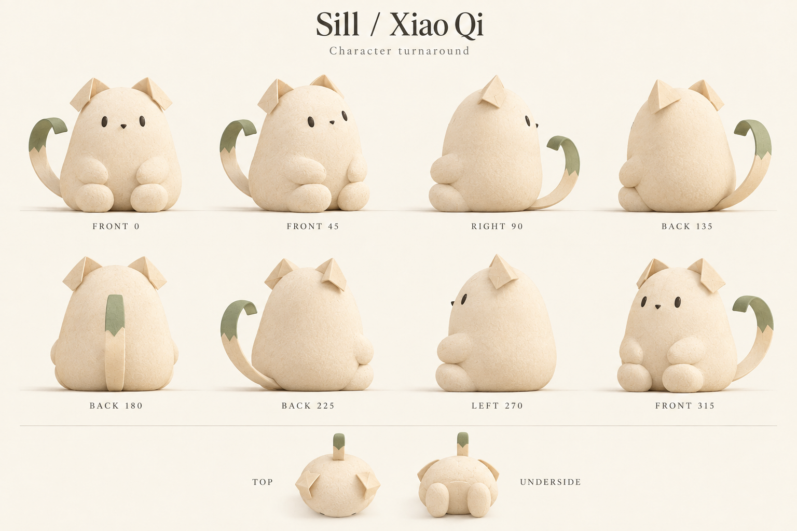
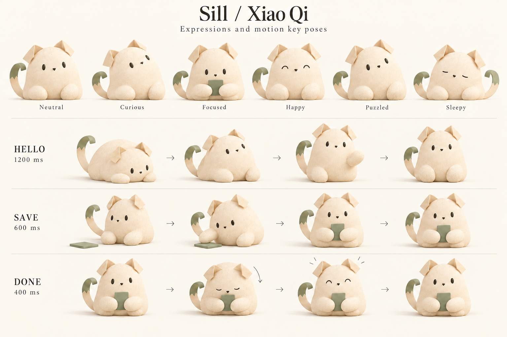

# 小栖角色与动画设计规范

更新：2026-10-29。用于 Sill 吉祥物的插画、建模、动画与安装窗口设计。角色名称为工作名「小栖」（Xiao Qi）。本文件规定角色设计；图稿为造型参考，尚未接入产品。

## 1. 品牌分工

保留现有 [Sill App icon](../../../assets/sill-icon.png)。Dock、应用程序文件夹、系统通知和 DMG 中可拖拽的应用均使用现有 icon。小栖是独立角色，不替换、不覆盖、不拼接到 App icon 中。

小栖用于安装背景、首次启动、空白页面、必要的操作反馈和宣传插画。阅读正文、卡片列表、导航与工具栏不常驻吉祥物。角色不是助手入口，不代表外部服务已完成任务。

## 2. 形象

小栖是一只住在窗台上的奶油白小猫。性格安静、好奇，动作轻，有一点笨拙。固定识别点为折纸耳朵、梨形身体、书签尾巴；绿色卡片是可取下的道具。

- 两只短三角耳朵，上部有一次向外折叠；不加内耳粉色。
- 头和身体连成柔和的梨形，不做明显脖子和球形大头。
- 深色小椭圆眼睛、小三角鼻；默认没有眉毛、胡须或可见嘴线。
- 两只短手臂、两只圆脚掌；手掌不画手指，脚掌不画肉垫。
- 尾巴为薄而有厚度的带状书签，从背部下方中央长出。末端为鼠尾草绿，有一个浅 V 形缺口；不做圆柱猫尾或分叉尾。
- 表面使用细纸纹或短绒般的哑光质感，不出现长毛、塑料高光、玻璃或金属效果。

## 3. 多角度设定

环绕图按镜头位置命名：正面 0°，向角色左侧绕行，每隔 45°一张，直到 315°；图中 RIGHT/LEFT 表示画面朝向，不作为骨骼左右命名。模型左右始终以角色自身为准。

| 视图 | 制作时检查 |
| --- | --- |
| 正面 0° | 眼睛高度一致；双耳与脚掌对称；尾巴可侧摆，但根部不移动 |
| 前侧 45°、315° | 远侧眼睛随透视收窄；远侧手臂自然遮挡 |
| 侧面 90°、270° | 脸部轻微凸出；身体下部较宽；尾根位于背部下方 |
| 后侧 135°、225° | 不露出眼睛或鼻子；远侧手脚按遮挡处理 |
| 背面 180° | 背部没有脸、花纹或接缝；尾根居中 |
| 俯视 | 两耳位于头顶两侧，身体前后厚度清楚 |
| 底视 | 两个脚掌和身体接触面平稳，不增加解剖细节 |

图稿用于造型探索，不是精确正交建模图。各角度的尾巴弯曲与耳朵折面存在差异。制作时以以下尺寸和同一个模型为准，再由该模型导出所有视角；不逐张独立建模。

## 4. 比例与颜色

以坐姿地面至耳尖的高度为 H=100，尺寸均为建模目标。尾巴不计入主体宽度。眼位从地面向上计算。

| 部位 | 相对尺寸 |
| --- | --- |
| 主体最宽处 / 侧面厚度 | 66 / 52 |
| 耳朵高度 / 单耳底宽 | 15 / 20 |
| 双眼中心高度 / 中心间距 | 69 / 23 |
| 单眼宽 × 高 | 3 × 6 |
| 鼻宽 / 鼻中心高度 | 4 / 65 |
| 单臂宽 × 长 | 13 × 23 |
| 单脚宽 × 高 | 21 × 16 |
| 尾巴展开长 / 宽 / 厚 | 72 / 8 / 2 |
| 尾根中心高度 / 绿色末段占尾长 | 18 / 25% |
| 卡片宽 × 高 | 24 × 33 |

| 材质色 | sRGB | 用途 |
| --- | --- | --- |
| Cream | `#F2E6CF` | 身体与尾巴主体 |
| Fold | `#D8C4A4` | 耳内折面、温和暗部 |
| Ink | `#36342C` | 眼睛和鼻子 |
| Sage | `#909B77` | 尾端与卡片道具 |
| Paper | `#FAF7EF` | 角色设定图背景 |

以上是角色材质色，不替换产品的 canvas、card、ink、accent 等界面变量。实际接入时将新增角色色保存到设计变量源文件，再生成产物。灯光可以改变画面明暗，不能把材质色改成不同角色。深色界面仍保留奶油白身体，减弱投影，不反转角色颜色。

## 5. 表情与动作

| 表情 | 变化 | 限制 |
| --- | --- | --- |
| 平静 | 小椭圆眼、自然坐姿 | 默认状态 |
| 好奇 | 头轻倾，视线抬起 | 不放大眼睛 |
| 专注 | 看向卡片，头稍低 | 不添加眼镜等固定配件 |
| 开心 | 眼睛收为短弧线，耳朵稍抬 | 不露牙、不大笑 |
| 困惑 | 头轻倾，手停在卡片旁 | 不哭泣，不责备用户 |
| 困倦 | 闭眼，身体伏低，尾巴绕身 | 只用于休息插画，不表示请求还在处理 |

## 6. 动画规格

动画只提供情绪反馈，操作结果仍由真实状态决定。以下是制作目标，不代表已实现。时长包括起势、主体动作与收势；关键姿势图不是可播放动画。

| 动画 | 触发条件 | 关键时间点 | 播放规则 |
| --- | --- | --- | --- |
| hello | 首次欢迎页可见 | 0ms 低姿；250ms 抬头；650ms 举手；1200ms 坐稳 | 每次欢迎流程一次 |
| save | 已确认保存成功 | 0ms 伸手；180ms 碰卡；420ms 抱入；600ms 停稳 | 不在每张信息流卡片旁播放 |
| done | 已确认 Sill 待办完成 | 0ms 静止；120ms 低头；260ms 抬耳；400ms 归位 | 单次；不表示外部任务完成 |
| idle | 带角色的空白页持续可见 | 一次眨眼 180ms，间隔至少 12 秒 | 不摇摆身体、不循环招手 |
| error | 操作确实失败 | 0ms 停住；200ms 看卡；500ms 静止 | 单次；保留具体错误及处理动作 |
| rest | 静态空白或宣传场景 | 伏下、闭眼、尾巴环绕 | 默认使用静态姿势 |

身体上下位移不超过 0.04H，头部倾斜不超过 8°，尾端摆动不超过 12°；不使用全身跳跃、撒花、强烈拉伸或闪光。一次最多一个角色动画，不增加声音和触觉反馈。

动画开始和结束都接入稳定姿势。新动作从当前可见姿势接续，不跳回第一帧；离开页面停止，旧回调失效。失败状态优先于成功反馈，装饰性 idle 优先级最低。不排队播放多次成功动作。不可见时停止计时，不影响输入、焦点、阅读和播放器。

接入时沿用现有系统偏好与动效机制，不新增专用开关。角色为装饰时不进入键盘焦点或重复读屏内容；结果不能只靠角色表情说明。

## 7. DMG 安装窗口

使用 Finder 的静态背景和真实文件图标，不在 DMG 中放自定义动画播放器或安装向导。

- 内容画布目标为 660 × 440 pt；背景提供 1320 × 880 px 的 2 倍素材。
- 上方居中标题「安装 Sill」，说明「将 Sill 拖到“应用程序”文件夹」。字体沿用产品系统字体，不采用概念海报中的衬线字体。
- 现有 App icon 中心位于 (220, 220)，应用程序快捷方式中心位于 (440, 220)，图标目标尺寸 88 pt；两者之间保留方向箭头。
- 小栖坐在左下角，角色高约 140 pt；不侵入图标、文件名或拖拽路径。
- 下方说明「复制完成后，从“应用程序”打开 Sill」。背景中的文字与角色都是静态内容，不能看起来像按钮。
- 使用浅色窗台和柔和日光。纹理、植物及投影保持低对比，不使用概念海报的满幅复杂场景。
- 不出现安装进度、复制完成或公证成功的虚假提示；复制过程由 Finder 呈现。

窗口尺寸和坐标由 `design-system/tokens/installer.json` 维护；文案由 `design-system/copy/zh-Hans/installer.json` 维护。背景制作与打包入口见[发布操作手册](../../implementation/operations/release-runbook.md)。实际 DMG 制作后需检查 Finder 文件标签、工具栏和缩放后的显示。

## 8. 制作交付与验收

当前提供两张静态设定图及本规范。生产阶段需要同一角色的可编辑模型或分层源文件、透明背景角色静帧、动画文件和安装背景；当前 PNG 不能替代这些源文件。

首轮[概念海报](../../../design-system/mascot/concept.png)保留用于设计追溯。其中的吉祥物 App icon 已被后续决定取消，不作为生产素材。正式[安装背景插画](../../../design-system/installer/background-art.png)不含图标和文字；打包时添加说明，Finder 显示现有 App icon。插画角色实际高度约 140 pt，页脚说明放在角色右侧，避免重叠。

- 分层建议：身体、左右耳、双眼、鼻、左右手、左右脚、尾根、尾中、尾端、道具和投影；尾巴保持连续，不出现分段接缝。
- 静态素材用 sRGB、透明 PNG，按实际展示尺寸输出 1 倍与 2 倍；设定图保留背景、标题和视角标签，不能直接作为界面素材。
- 动画保持透明背景与统一画布、原点、脚底基线；Web 与 Mac 共享时序与状态含义，文件格式在接入时按现有播放能力确定。
- 检查 48、96、160 pt 三档显示：48 pt 简化纸纹与投影，保持双耳、尾端和眼睛可认；低于 48 pt 不使用完整角色。
- 检查浅色、深色背景和动画首尾帧；确认尾根位置、耳朵数量、眼距、材质和道具尺寸一致。
- 核对现有 App icon 未改变，DMG 拖拽对象仍是实际 App 与 Applications 快捷方式。
- 运行态检查需在实现后执行；此设计交付不表示 App、动画或安装流程已经上线。
